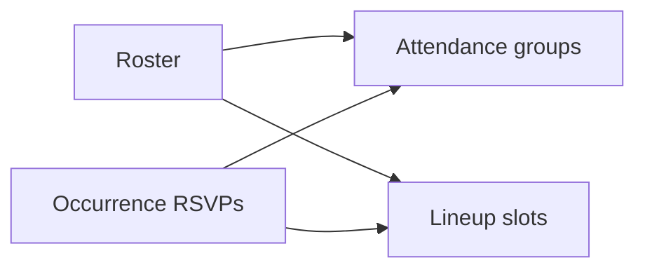

# Attendance and lineup

Attendance is a rollup of RSVPs the app already stores, on every event. A lineup is a new ordered list of players for one game date. Practices, meetings, and other events do not have a lineup. Formations stay out: teams already use free-text positions, and the product is not one sport.

## Attendance

On the event sheet in [client/expo/app/(main)/schedule/index.tsx](<client/expo/app/(main)/schedule/index.tsx>), replace the flat “Responses” list with four groups and counts: Going, Maybe, No, and No reply.

- Going, Maybe, and No come from `occurrence.rsvps` (`going` | `maybe` | `not_going` on [lib/schemas/src/schedule.ts](lib/schemas/src/schedule.ts)).
- No reply is every roster member with no RSVP for that occurrence. Load the roster the team page already uses.
- **Short** is the count of members whose role is `player` and whose RSVP is not `going`. Show that count above the groups.
- Any team member can see this. Writing RSVPs stays as it is.

## Lineup

One lineup per game occurrence, same identity RSVPs use (`eventId` + `occurrenceStartsAt`), so a recurring game has a different lineup each date. The event’s `eventType` must be `game`. `GET` and `PUT` return `not_a_game` for any other type, and the sheet does not render a lineup section.

Stored on the team partition as a single item, `LINEUP#<occurrenceStartsAt>#<eventId>`, with an ordered `slots` array. Each slot is `{ userId, position }`. `position` is a string up to 40 characters, prefilled from that member’s positions on the team when the coach picks them.

- `GET /schedule/teams/:teamId/lineup?eventId&occurrenceStartsAt` — any member. Missing item returns an empty lineup.
- `PUT` the same path — `manage_events`, the permission that already covers creating events. Body replaces the whole slot list (max 30 slots, each `userId` at most once, `userId` must be a current member).
- Add the key helper next to `rsvpSk` in [functions/lib/dynamo/keys.ts](functions/lib/dynamo/keys.ts). Schemas live in [lib/schemas/src/schedule.ts](lib/schemas/src/schedule.ts) and the OpenAPI map. Regenerate [lib/types/src/generated/schema-types.ts](lib/types/src/generated/schema-types.ts).

On a game, the sheet shows the lineup under attendance. Members with `manage_events` can add a player, set the position, reorder, and remove. Others see the list read-only. A **Copy from previous** action copies slots from the latest earlier game occurrence of the same series when one exists.

## Copy and tests

Strings in [client/expo/src/en.json](client/expo/src/en.json) and [client/expo/src/es.json](client/expo/src/es.json). Handler tests follow the existing RSVP cases in [functions/schedule/src/handler.test.ts](functions/schedule/src/handler.test.ts): empty get on a game, put and get round-trip, forbidden without `manage_events`, duplicate user rejected, and `not_a_game` for a practice.
