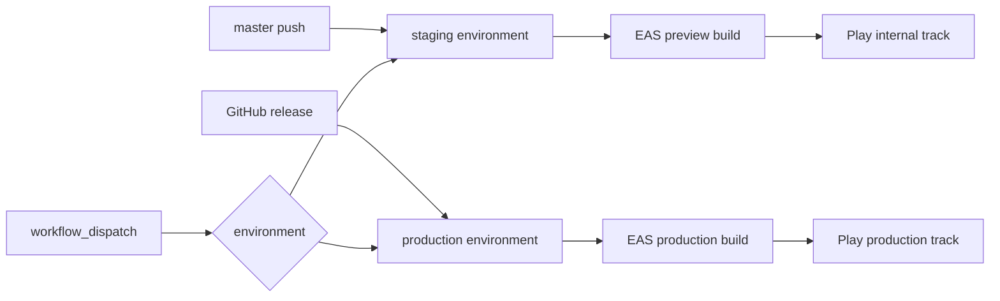

# Expo Android deployments

The phone app is the Expo client in [`client/expo`](client/expo). [`package.json`](package.json) `client:build` and [`.github/workflows/deploy-client.yml`](.github/workflows/deploy-client.yml) already publish that app’s web export. [`client/app`](client/app) (Angular plus Capacitor, including [`client/app/android`](client/app/android)) is not referenced by root scripts, CI, or either deploy workflow. This change deletes that tree. Android shipping is EAS only.

## Trigger and tracks

New workflow [`.github/workflows/deploy-android.yml`](.github/workflows/deploy-android.yml), same triggers and GitHub environments as the website and API:

- Push to `master` uses the `staging` environment and submits to the Play **internal** track.
- A published GitHub release uses `production` and submits to the Play **production** track.
- `workflow_dispatch` chooses `staging` or `production`.

Pull-request CI stays JavaScript-only (`npm run typecheck`, `npm test`, `npm run test:app`). It does not build a native binary.

## App config

Add [`client/expo/eas.json`](client/expo/eas.json) with `preview` and `production` profiles. Both use `distribution: store` and remote `versionCode` so Play never sees a repeated code. Env for each profile comes from the same Parameter Store values the website already loads (`API_BASE_URL`, and the WebSocket and maps values derived the way [`client/expo/scripts/run.mjs`](client/expo/scripts/run.mjs) does). `EXPO_PUBLIC_*` is baked in at build time, so a staging binary keeps calling staging until a new binary ships.

Extend the `android` block in [`client/expo/app.json`](client/expo/app.json) (`package` is already `com.gameplan.app`):

- Adaptive icon and `versionCode` owned by EAS.
- Google Maps key in the native manifest (required by `react-native-maps` on Android; the JS `EXPO_PUBLIC_GOOGLE_MAPS_API_KEY` does not cover that).
- `google-services.json` for Firebase Cloud Messaging (FCM). [`client/expo/src/push.ts`](client/expo/src/push.ts) sends `getDevicePushTokenAsync()` to the API; without the FCM file the install works and push registration gets an empty token.

`version` in `app.json` follows the release tag for production builds. Staging may keep the current version string and only bump `versionCode`.

## Workflow steps

On `ubuntu-latest`, with `id-token: write` and `contents: read`, concurrency `deploy-android-<environment>`, `cancel-in-progress: false`:

1. Checkout, Node 22, `npm ci`.
2. Assume `secrets.AWS_ROLE_ARN` and run `npx tsx infrastructure/scripts/load-ssm-env.ts client`, same as the website workflow.
3. `eas build --platform android --profile <preview|production> --non-interactive` with `EXPO_TOKEN`.
4. `eas submit --platform android --profile <same> --non-interactive` to the matching Play track.

No Android SDK on the runner. EAS runs prebuild, so native dependency bumps (`expo-notifications`, `react-native-maps`) do not require a checked-in `android/` directory under `client/expo`.

## Secrets to add before the first green run

- `EXPO_TOKEN` on the GitHub environments.
- Play Console app `com.gameplan.app`, Play App Signing enabled, and a service-account JSON with release permission, stored for EAS Submit.
- FCM `google-services.json` as an EAS file secret, not committed.
- Maps key restricted to the Android package and signing certificate. Reuse the existing public maps key only if its restrictions allow that package.

Until the Play service account exists, `workflow_dispatch` can run the build and upload the Android App Bundle (AAB) as a GitHub artifact, and the submit step stays off. Internal-track submit is the default once that secret is present.

## Remove Angular and Capacitor

Delete the [`client/app`](client/app) workspace (`@gameplan/app`, the Capacitor `android/` and `ios/` projects, and `client/app/plugins/place-search`). Root `npm test` does not run those specs. [`local/Dockerfile.client`](local/Dockerfile.client) copies `client/` after install and only lists the Expo and session package manifests, so removing the folder is enough for Compose.

Then drop Capacitor-only session code. Expo imports `RefreshStore` and the session service from `@gameplan/client-session` and keeps its own store in [`client/expo/src/refresh-store.ts`](client/expo/src/refresh-store.ts). Remove `CapacitorRefreshStore`, `PreferencesLike`, and `CAPACITOR_REFRESH_KEY` from [`client/session/src/refresh-store.ts`](client/session/src/refresh-store.ts), the exports in [`client/session/src/index.ts`](client/session/src/index.ts), and the Capacitor cases in [`client/session/src/session.test.ts`](client/session/src/session.test.ts).

Point leftover docs and comments at Expo:

- [`README.md`](README.md): website reload is Expo, and the client image no longer “skips Angular”.
- [`docs/maps/README.md`](docs/maps/README.md): browser key is `EXPO_PUBLIC_GOOGLE_MAPS_API_KEY` via [`client/expo/scripts/run.mjs`](client/expo/scripts/run.mjs). Android key goes in the Expo manifest config, not `android/local.properties` or the Angular bundle.
- Comments in [`infrastructure/lib/storage.ts`](infrastructure/lib/storage.ts) and [`infrastructure/bin/app.ts`](infrastructure/bin/app.ts) that still say Angular.
- Drop `client/app/.angular/cache` from [`.gitignore`](.gitignore).

Regenerate `package-lock.json` with `npm install` so `@gameplan/app` and the `@capacitor/*` dependencies leave the lockfile.

Leave old files under `.cursor/plans/` as history. Do not edit them.

## Out of scope

- iOS and App Store Connect.
