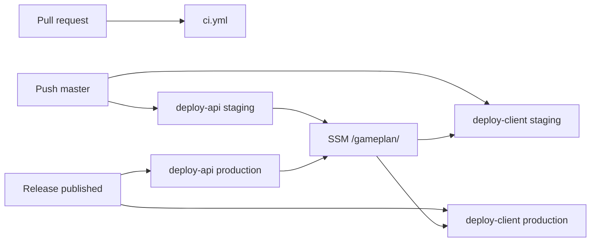

# GitHub Actions CI/CD

Staging and production keep the existing `GamePlanStack` and fixed resource names, in **separate AWS accounts**. Both accounts use the same Parameter Store prefix `/gameplan/`. GitHub Environments pick the account: `staging` on push to `master`, `production` when a release is published. API deploy and website publish are separate workflows so either can be re-run on its own.

## Auth

GitHub does not store app secrets. Each environment has one secret, `AWS_ROLE_ARN`, and variables `AWS_REGION` (`us-east-1`) and `SSM_PREFIX` (`/gameplan`).

Jobs that deploy set `permissions: id-token: write` and `contents: read`, then `aws-actions/configure-aws-credentials` with OIDC. Trust policies allow only `repo:<owner>/<repo>:environment:staging` and `...:environment:production`. The production environment gets required reviewers. The deploy role is created once per account (outside this stack, so a stack delete cannot remove the role that deploys it). It needs CloudFormation/CDK deploy permissions plus `ssm:GetParametersByPath` and `ssm:PutParameter` on `/gameplan/*`. No KMS decrypt permission is required, because nothing under the prefix is a SecureString.

## Parameter contract

Every parameter under `/gameplan/` is a Parameter Store **String** (`Type=String`), including social client secrets, the Apple private key, and `google-maps-api-key`. The loader calls `GetParametersByPath` without decryption. Values are still masked in the Actions log and never printed. Missing social keys stay optional, matching [infrastructure/lib/auth.ts](infrastructure/lib/auth.ts) (an IdP is created only when its full set is present).

- Config: `client-origin` → `CLIENT_ORIGIN`, `callback-urls` → `CALLBACK_URLS`, `logout-urls` → `LOGOUT_URLS` (comma-separated).
- Social: `google-client-id` / `google-client-secret`, `facebook-app-id` / `facebook-app-secret`, `apple-client-id` / `apple-team-id` / `apple-key-id` / `apple-private-key`.
- Maps: `google-maps-api-key` (places Lambda), `google-maps-browser-api-key` (website bundle).
- Publish targets written by the API workflow after deploy, also as Strings: `api-base-url`, `ws-base-url`, `site-bucket-name`, `site-distribution-id`, `site-url`.

[infrastructure/bin/app.ts](infrastructure/bin/app.ts) will read social credentials and callback/logout URLs from those env vars, and keep CDK context as the local override. Secrets stay off the `cdk` argv. `GOOGLE_MAPS_API_KEY` is already read in [infrastructure/lib/api.ts](infrastructure/lib/api.ts). Cognito still stores IdP secrets in the template (`SecretValue.unsafePlainText`); the account boundary is the protection.

First deploy in an account: set `client-origin`, `callback-urls`, and `logout-urls` before the API workflow (a custom domain, or placeholder URLs). After that deploy, copy `HttpApiUrl` into `callback-urls` and `SiteUrl` into `client-origin` / `logout-urls` if they were placeholders, then re-run the API workflow. Later deploys are stable because API Gateway and CloudFront URLs do not change. The client workflow fails clearly if `api-base-url` or the site bucket outputs are missing.

## Workflows

**[`.github/workflows/ci.yml`](.github/workflows/ci.yml)** on pull requests and pushes. No AWS. Node 22, `npm ci`, then `npm run typecheck`, `npm test`, and `npm run test:app`. `cdk synth` is not run here; it needs the account parameters.

**[`.github/workflows/deploy-api.yml`](.github/workflows/deploy-api.yml)** on push to `master` (`staging`), `release: published` (`production`), and `workflow_dispatch`. Concurrency group per environment so two deploys cannot overlap. Steps: `npm ci`, load `/gameplan/`, require origin and callback/logout URLs, `npm run deploy -w @gameplan/infrastructure` with `--outputs-file`, then `PutParameter` the HTTP API URL, WebSocket URL, site bucket, distribution id, and site URL back under the same prefix.

**[`.github/workflows/deploy-client.yml`](.github/workflows/deploy-client.yml)** with the same triggers, separate concurrency. Load SSM, require `api-base-url`, `site-bucket-name`, and `site-distribution-id`. `BUILD_CONFIGURATION=production` so [client/app/scripts/write-environment.mjs](client/app/scripts/write-environment.mjs) writes the production environment, then `npm run client:build`. Sync `client/app/dist/app/browser` to the site bucket and invalidate the distribution. Parallel with the API workflow is safe after the first bootstrap because those values do not change on a normal API deploy.

Mobile store builds stay out of these workflows.

## Docs

Add a short Cloud section to [README.md](README.md): prefix, parameter names, GitHub environments, and the one-time OIDC role. No app secrets in GitHub.