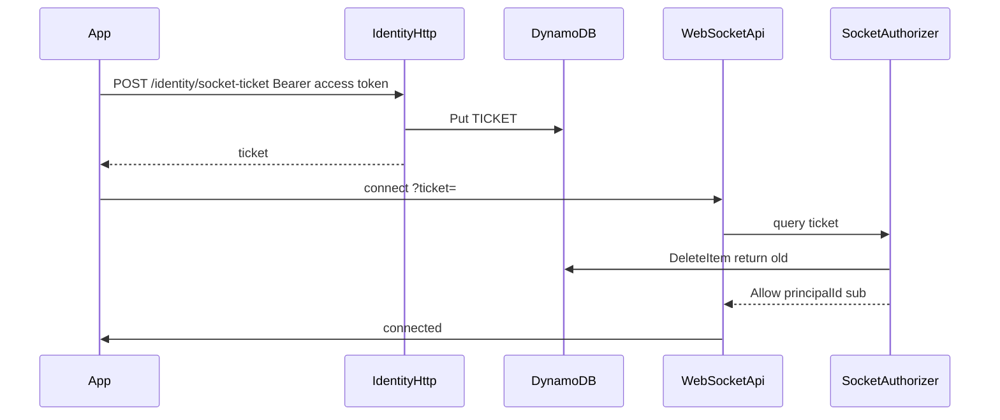

# Socket connect ticket

The access token stays on `Authorization: Bearer` for `POST /identity/socket-ticket`. The socket URL becomes `wss://…/socket?ticket=<opaque>`. A logged handshake cannot call the HTTP API.

## Ticket row

Add key helpers in [functions/lib/dynamo/keys.ts](functions/lib/dynamo/keys.ts): partition `TICKET#<id>`, sort key `TICKET`. The authorizer only has the ticket, so the lookup starts at that partition and does not need a GSI.

Store `userId` and `ttl` (60 seconds). Time-to-live only cleans abandoned rows. DynamoDB TTL can lag, so the security control is an atomic delete.

Add `issueSocketTicket` and `redeemSocketTicket` in a shared module under `functions/lib` (identity and the socket authorizer are separate Lambdas). Issue with `crypto.randomBytes` as base64url. Redeem with `DeleteItem`, `ConditionExpression: attribute_exists(PK)`, and `ReturnValues: ALL_OLD`. A second redeem gets nothing and is rejected.

## Issue the ticket

Identity is open at the HTTP gateway (`PUBLIC_HTTP` in [infrastructure/lib/api.ts](infrastructure/lib/api.ts)), so the handler verifies the bearer itself, the same way [functions/identity/src/routes/me.ts](functions/identity/src/routes/me.ts) calls `verifyAuthHeader`.

- Route: `POST /identity/socket-ticket` in [functions/identity/src/handler.ts](functions/identity/src/handler.ts).
- Response: `{ ticket, expiresIn: 60 }`.
- Schema: Zod object in [lib/schemas/src/auth.ts](lib/schemas/src/auth.ts), path in [lib/schemas/src/openapi.ts](lib/schemas/src/openapi.ts) with `secured: true`, then regenerate [lib/types/src/generated/schema-types.ts](lib/types/src/generated/schema-types.ts).

## Burn it on connect

[functions/socket/src/authorize.ts](functions/socket/src/authorize.ts) reads `queryStringParameters.ticket`, redeems it, and returns the existing allow policy (`principalId` and `context.sub` = user id). Missing, expired, or already-used tickets throw `Unauthorized`.

[functions/socket/src/routes/connect.ts](functions/socket/src/routes/connect.ts) stays as it is. [functions/socket/src/resolve-user.ts](functions/socket/src/resolve-user.ts) already prefers authorizer context, which is set in the cloud after the ticket is burned. The local server in [local/src/serve-socket.ts](local/src/serve-socket.ts) has no authorizer, so the query fallback redeems the ticket there instead of calling `verifyAccessToken`. Do not keep accepting the access JWT on the socket.

## Gateway cache and permissions

In [infrastructure/lib/api.ts](infrastructure/lib/api.ts):

- Point `identitySource` at `route.request.querystring.ticket`.
- Set `resultsCacheTtl` to 0 seconds. The default cache would Allow a replayed ticket without running the Lambda.
- Give the authorizer function `TABLE_NAME` and `grantReadWriteData`. It is created with `createFunction` and only `cognitoEnv` today, so it cannot see the table.

## Client

[client/app/src/app/core/api-client.service.ts](client/app/src/app/core/api-client.service.ts) gains `issueSocketTicket()`, using the existing authorized `fetch` (header, refresh-on-401, native HTTP).

[client/app/src/app/core/live-socket.service.ts](client/app/src/app/core/live-socket.service.ts) requests a ticket, then opens the socket. On `close`, it waits and requests a new ticket. It does not keep the previous ticket or the access token in the URL. [client/app/src/app/app.component.ts](client/app/src/app/app.component.ts) and [client/app/src/app/features/auth.ts](client/app/src/app/features/auth.ts) call `connect()` without passing the access token.

## Tests

- Redeem succeeds once and fails the second time.
- Authorizer allows a fresh ticket and rejects a missing or reused one.
- Identity route returns a ticket for a valid bearer and `401` without one.
- Live socket puts `ticket=` on the URL and fetches again after close.
