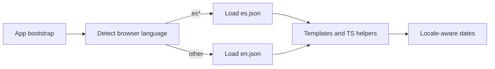

# Spanish i18n (browser/device language)

## Approach

Use **runtime** i18n with [@jsverse/transloco](https://jsverse.gitbook.io/transloco) (Angular-first, works with standalone + Capacitor; no per-locale rebuilds).

- Detect language once at app start from `navigator.languages` / `navigator.language` (Capacitor uses the same WebView locale).
- Map any `es*` tag to `es`, everything else to `en`.
- No in-app picker and no saved preference in this pass.
- Translate UI copy and client-side message helpers; leave unknown API error codes as generic fallbacks / unchanged codes.
- Drive `Intl` / `DatePipe` from the active locale (stop hard-coding `en-US` in schedule).



## Scaffolding

- Add `@jsverse/transloco` in [`client/app/package.json`](client/app/package.json).
- Create assets:
  - [`client/app/src/assets/i18n/en.json`](client/app/src/assets/i18n/en.json)
  - [`client/app/src/assets/i18n/es.json`](client/app/src/assets/i18n/es.json)
- Ensure `assets/i18n` is included in [`client/app/angular.json`](client/app/angular.json) (default `src/assets` already covers this).
- Add [`client/app/src/app/core/i18n.ts`](client/app/src/app/core/i18n.ts):
  - `SUPPORTED_LANGS = ['en', 'es']`
  - `detectBrowserLang()` → `'en' | 'es'`
  - `provideAppTransloco()` wrapping `provideTransloco` + HTTP loader + `provideTranslocoLocale` if needed
- Wire providers in [`client/app/src/app/app.config.ts`](client/app/src/app/app.config.ts).
- On bootstrap (or a small `APP_INITIALIZER` / `provideAppInitializer`), set `document.documentElement.lang` and register Angular locale data for `es` via `registerLocaleData(localeEs)` + provide `LOCALE_ID` from the detected language so `DatePipe` formats correctly.

## Catalog shape

Flat namespaced keys, e.g.:

```json
{
  "nav.teams": "Teams",
  "nav.profile": "Profile",
  "role.team_admin": "Team admin",
  "profile.savePhone": "Save phone",
  "errors.couldNotLoadProfile": "Could not load that profile."
}
```

Spanish file mirrors the same keys. Keep keys stable; English values match current copy.

## Migration pattern

**Templates:** replace literals with the Transloco pipe / structural directive:

- `{{ 'nav.teams' | transloco }}`
- `[attr.aria-label]="'profile.teamLogo' | transloco"`
- `mat-label` / placeholders the same way

**TypeScript helpers:** inject `TranslocoService` (or a thin `I18nService` wrapper) and replace maps like:

- [`ROLE_LABELS` / `roleLabel`](client/app/src/app/features/teams.ts)
- [`EVENT_TYPE_LABELS`](client/app/src/app/features/add-event-form.ts)
- [`LABELS` in theme-toggle](client/app/src/app/core/theme-toggle.ts)
- error mappers (`joinRequestMessage`, `positionMessage`, invite/auth errors, profile upload errors)

**Route titles** in [`app.routes.ts`](client/app/src/app/app.routes.ts): keep a key in `data.titleKey` and resolve via Transloco in the layout title binding (instead of hard-coded English `data.title`).

**Dates:** update [`schedule-calendar.ts`](client/app/src/app/features/schedule-calendar.ts) so `Intl.DateTimeFormat` uses the active app locale (not `'en-US'`). Keep `WEEKDAY_LABELS` as stable English tokens only where used for `rrule` matching; display labels come from `Intl` or translation keys.

## Rollout order (same PR if feasible, else stacked commits)

1. Scaffold Transloco + `en`/`es` skeletons + locale detection + `html lang` / `LOCALE_ID`
2. Shell: [`app-layout`](client/app/src/app/layout/app-layout.html), theme toggle, modal, route titles
3. Auth / complete-profile / invite
4. Teams + team-admin + member-profile
5. Profile
6. Chats + chat-thread
7. Schedule + add-event-form + calendar formatters

Spanish translations land with each area as keys are extracted (not English-only stubs left behind).

## Out of scope for this pass

- In-app language picker / persisted override
- Server-localized API error payloads
- Additional languages beyond `es`
- Translating time zone IDs or user-generated content (team names, messages, positions)

## Verification

- Manually: set browser language to Spanish → UI + month/weekday formatting in Spanish; set to English → English.
- Unit smoke: `detectBrowserLang()` cases (`es`, `es-MX`, `en-US`, `fr` → `en`).
- Existing feature specs: update any assertions that match hard-coded English copy that moved to keys, or stub Transloco in `TestBed`.
