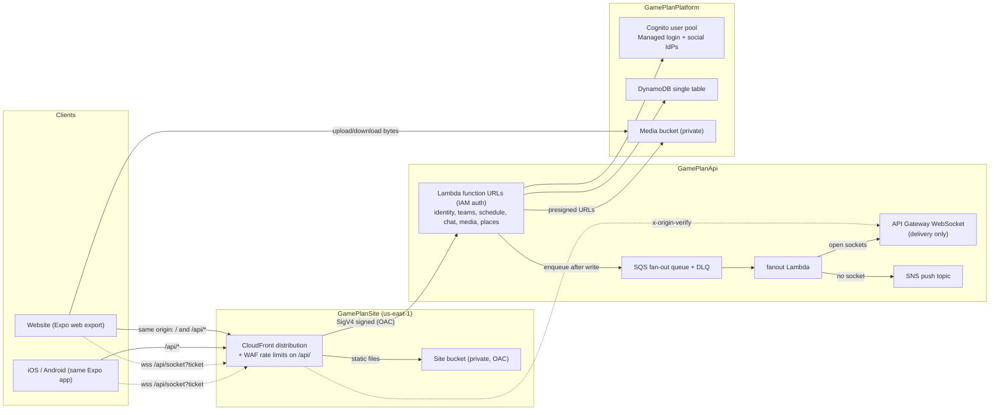

# GamePlan architecture

This document explains how GamePlan is put together and why. It covers the stack choice, the code-level design of
the API and the client cache, the DNS and hostname layout, what has been done for bundle size and latency, and the
security model. Each section ends with the trade-offs that were weighed and the known gaps worth improving.

For setup steps, routes, and deploy instructions, see [`README.md`](README.md).

## System overview



The product is split into **areas**: `identity`, `teams`, `schedule`, `chat`, `media`, `places`, `socket`, and
`fanout`. Each area is one Lambda function with its own routes under `functions/<area>`. Areas never call each other
directly. They share data through the DynamoDB table and hand off side effects through the fan-out queue.

### Repository layout

| Path               | Role                                                                                         |
| ------------------ | -------------------------------------------------------------------------------------------- |
| `lib/schemas`      | Zod request and response schemas. The single source of truth for wire contracts.            |
| `lib/types`        | Plain TypeScript types generated from `lib/schemas`, plus domain constants.                  |
| `lib/rules`        | Pure business rules shared by the API and the client (roles, minor rules, search policy).   |
| `lib/pipeline`     | Typed middleware pipeline core. No dependencies and no HTTP types.                           |
| `functions/lib`    | Server-only shared code: auth, DynamoDB access, route pipeline, guards, permissions.        |
| `functions/<area>` | One Lambda per product area.                                                                 |
| `client/session`   | Session client used by every platform (token refresh, request signing helper).              |
| `client/expo`      | The website and the native apps, one Expo Router tree.                                       |
| `infrastructure`   | AWS CDK app with four stacks.                                                                |
| `local`            | Laptop stand-in: a proxy that runs every area as a local process against DynamoDB Local.    |

`api`-side code and `client`-side code only meet through `lib/*`. The client never imports Zod or server code.

## Stack choice

### TypeScript everywhere

The API, the CDK app, the shared libraries, and the client are all TypeScript in one npm workspace.
Contracts are written once in Zod (`lib/schemas`), validated on the server, and converted to plain types for the
client by `npm run generate:types`.

- **Why:** one language and one type system means a contract change breaks the build on both sides at once.
- **Trade-off:** the generated types file is committed, so a schema edit needs a regeneration step. `npm run
  typecheck` runs it so CI catches a stale file.

### Expo (React Native) for web, iOS, and Android

One Expo Router app produces the website (static export) and the store apps. Platform-specific pieces use
`.native.tsx` files (map picker, day field, time clock).

- **Why:** a small team gets three platforms from one codebase and one set of screens.
- **Trade-off:** the website carries React Native Web, which is heavier than a web-only React app, and some
  browser behaviors (maps, push) need separate web implementations.

### Serverless on AWS: Lambda, DynamoDB, Cognito

- **Lambda per area.** Each area deploys and scales on its own, has its own IAM role, and its bundle only
  contains its own routes. Functions run Node.js 22 on ARM64 (Graviton) with 512 MB, which is cheaper per
  millisecond than x86.
- **DynamoDB single table, on-demand.** Every access pattern starts at a partition key (`USER#`, `TEAM#`, `CHAT#`,
  `INVITE#`, `TICKET#`, `HANDOFF#`). Global secondary indexes exist only where a lookup cannot start from a
  partition: exact email search and finding a socket by connection id. Both project keys only.
- **Cognito.** Managed login handles email/password, email verification, and Google, Apple, and Facebook sign-in
  without running an auth server.
- **No VPC.** Nothing needs private networking, so functions avoid VPC cold-start and NAT costs.

Trade-offs weighed:

- Serverless scales to zero, which suits a product with spiky weekend traffic. The cost is cold starts and
  per-request pricing that can overtake a small always-on container at sustained high load.
- A single table keeps queries to one round trip, but access patterns must be designed up front. Adding a new
  query that cannot start at a partition key needs a new index or a denormalized row.
- Cognito is low-maintenance but hard to migrate away from (password hashes cannot be exported), and its Managed
  login styling is limited.

### Lambda function URLs instead of API Gateway HTTP API

HTTP traffic goes CloudFront → Lambda function URL. There is no API Gateway in the HTTP path. The WebSocket still
uses API Gateway because function URLs cannot hold WebSocket connections.

- **Why:** one fewer network hop, no API Gateway per-request charge, and CloudFront already provides TLS, the
  custom domain, compression, and WAF.
- **Costs of this choice:**
  - There is no gateway JWT authorizer, so every protected route verifies the Cognito access token inside the
    function (`functions/lib/auth/cognito.ts`).
  - CloudFront origin access control (OAC) signs requests with SigV4 but does not hash the body, so clients must
    send `x-amz-content-sha256` on writes (`withContentHash` in `client/session`). React Native has no Web Crypto
    digest, so SHA-256 is implemented in plain TypeScript.
  - OAC overwrites `Authorization`, so a CloudFront Function copies the bearer token into
    `x-viewer-authorization` before signing.
  - API Gateway throttling and X-Ray stage tracing are gone. WAF handles rate limiting, and functions enable
    active X-Ray tracing themselves.

### Realtime: WebSocket for delivery, HTTP for writes

Clients send messages and RSVPs over HTTP. The writing area stores the row, then enqueues a fan-out job on SQS.
The fan-out function posts to open sockets, and falls back to SNS / Web Push / device push for users with no
open socket. A live socket never also gets a push.

- **Why:** writes stay on the validated, rate-limited HTTP path. The socket carries no business logic, so a lost
  connection never loses data. The queue makes delivery retryable (dead-letter queue after five attempts) without
  slowing the write response.
- **Trade-off:** a message reaches other users a little later than a direct socket broadcast would, and delivery is
  at-least-once, so clients must tolerate duplicates.

### Four CDK stacks

`GamePlanDns` → `GamePlanPlatform` → `GamePlanApi` → `GamePlanSite`, passing values through CloudFormation
exports. Staging and production are the same stacks in **separate AWS accounts**.

- **Why:** long-lived, stateful resources (Cognito, the table, the media bucket) sit in a stack that rarely
  changes, so an API deploy cannot recreate them. The site stack deploys last, so the distribution can reference
  the function URLs directly and the API stack never references the distribution (no dependency cycle).
- **Why separate accounts:** a staging mistake cannot touch production data or IAM, and resource names can stay
  identical in both.
- **Trade-off:** CloudFormation refuses to change an export that another stack imports. Renames need a staged,
  multi-step deploy (see the one-time migration in the README, and the pinned certificate below).

## Code-level design

### Route pipelines

Every HTTP route is built with `route` from `functions/lib/pipeline.ts`: optional path-parameter names, a flat
list of steps, then the handler.

```ts
export const handleSendMessage = route(
  ['chatId'],
  withChatErrors(),
  requireUser(),
  withBodyValidation(sendMessageBodySchema),
  async ({ chatId, user, body }) => { /* ... */ },
);
```

Steps run in the order they are listed, and the first step is the outermost one. A step can stop the request by
returning a response, or attach fields to the context and call `next`. The handler receives every field attached
along the way.

How this shapes the code:

- **Order is visible.** A route reads top to bottom as the order checks run. There are no nested wrappers to
  unpick, and adding a guard is one line.
- **The compiler checks step order.** Each step declares the fields it needs and the fields it adds. A step placed
  before the step that provides its input fails to compile. For example, `requireMembership()` needs `teamId` and
  `user`. The handler's context is typed exactly, so handlers never write `ctx.user!` or re-check that a guard
  ran.
- **Failures are thrown codes, not responses.** Guards and services throw short codes such as `not_a_member`,
  `forbidden`, or `team_not_found`. Each area's error step (`withTeamsErrors()`, `withChatErrors()`, and so on)
  is listed first and maps those codes to status codes in one place. Business code stays free of HTTP.
- **Validation sits at the edge.** `withBodyValidation` and `withQueryValidation` parse the request before the
  handler runs and return a stable `400 { errors: [{ field, message }] }`. Both accept any
  [Standard Schema](https://standardschema.dev), which today means the Zod schemas in `lib/schemas`.
- **The core does not know about HTTP.** `lib/pipeline` holds the step type, the compile-time checks, and generic
  `catchErrors` and `validate` steps. `functions/lib/pipeline.ts` binds them to the Lambda event and result
  types. The same core could run queue consumers or another HTTP framework, and it can be published on its own.

How this affects performance:

- **Cheap checks go first.** Routes list steps from cheapest to most expensive: error mapping, then `requireUser`
  (token verification, local once the signing keys are cached), then body and query validation (CPU only), then
  guards that read DynamoDB (`requireMembership`, then `requirePermission`). A malformed or unauthenticated request
  is rejected before any table read. The types only enforce data dependencies, so this ordering is a convention to
  keep in review.
- **Guards reuse what earlier guards loaded.** `requirePermission` needs the `member` attached by
  `requireMembership` and checks its roles, so it only reads the team's permission matrix. A permission-checked
  route costs two DynamoDB calls: the roster row and the matrix.
- **Chains are built once.** `route` composes the steps when the module loads. Per request, the cost is one
  function call and one shallow context copy per step. There is no router library, reflection, or decorator
  metadata, and the types are erased from the bundle.
- **Path parameters are positional.** The area dispatcher passes path segments as plain arguments, and `route`
  copies them onto the context by name. Nothing parses the URL a second time.

Trade-offs:

- The compile-time checks use recursive tuple types. They slow type checking slightly, and when a call fails both
  `route` signatures, TypeScript reports only the second, so the message can be vague.
- The path-parameter names in `route([...])` must match the order the dispatcher passes arguments in. That pairing
  is not type-checked against the URL.

### Hand-written dispatch per area

Each area's `handler.ts` matches the method and path segments with plain conditionals and calls the route
function with the segments it needs. `logHttpFailure` wraps the dispatcher and logs every `4xx` and `5xx`.

- **Why:** no router dependency, nothing to build at cold start, and the full route table for an area is one
  readable file.
- **Trade-off:** branch order matters, and the URL shape is matched by hand. Function URLs forward every path, so
  a missing branch shows up as a `404` at run time rather than a build error.

### State that survives warm invocations

Expensive setup lives at module scope and is created on first use: the DynamoDB document client, the Cognito
token verifier with its cached signing keys, and the five-minute Parameter Store cache. A warm container pays
these costs once. Each module exports a reset function (`resetDocClient`, `resetAccessVerifier`,
`resetParameterCache`) for tests, so no handler holds its own copy.

### Improvement opportunities

- **Typed dispatch.** Declaring each route's method and path pattern (`/teams/:teamId/members/:memberUserId`)
  once, and deriving both the dispatcher and the path-parameter names from it, would remove the hand-kept pairing
  between `handler.ts` and `route([...])`.

### Client queries

The Expo app loads product data through TanStack Query. Query keys, query functions, and cache writes live in
`client/expo/src/queries/`. Screens call those factories; they do not fetch in `useEffect` or keep a second cache.

- **One client, one key space.** `createQueryClient` (`src/query-policy.ts`) reuses a loaded value for 30 seconds
  and retries only transient failures (`TypeError` or `http_5xx`, at most twice). `queryKeys` in `queries/keys.ts`
  is the only place a cache entry is named, so invalidation and `setQueryData` agree.
- **Permissions share that cache.** `useTeamAccess` (`src/team-access.ts`) reads `permissionsQuery` with a
  60-second stale time. Saving permissions writes the returned rows back into the cache. The check is still
  `canWithRoles` from `lib/rules`, the same function the API's `requirePermission` uses.
- **Live events update the cache, not the screen.** `useLiveQuerySync` in the signed-in shell prepends
  `chat_message` onto a thread that is already loaded (skipping duplicates, never inventing a one-message page)
  and invalidates the chat list. Schedule and join-request events invalidate the matching team prefix.
- **Writes that can wait for the network.** Mutations default to `networkMode: 'always'`, so they fail as soon as
  the device is offline. RSVP, carpool, and lineup use `networkMode: 'online'`, pause while disconnected, and
  resume after a relaunch. Chat sends are not queued.
- **NetInfo drives online state.** TanStack's `onlineManager` treats unknown connectivity (`null`) as online so
  launch does not flash an offline state. Only a definite `false` pauses requests. On iOS and Android, focus
  follows `AppState`, so returning to the foreground refetches stale data at the same time the live socket
  reconnects. The website keeps TanStack's `visibilitychange` default.
- **Persisted cache is per user, not credentials.** `PersistQueryClientProvider` writes successful queries of
  known kinds (profile, teams, roster, permissions, schedule, chat list, and so on) to AsyncStorage for 24 hours.
  Presigned download URLs, message history, directory pages, and invite previews are left out: they expire, page,
  or are chat content. The refresh token stays in SecureStore or the HttpOnly cookie. A sibling storage key
  records the user id the cache belongs to. Restore waits until the session user is known and uses
  that id as the persist buster, so a different account's teams and profile are discarded instead of painted.
  Sign-out clears both memory and storage.
- **The schedule belongs to the athlete. Brand belongs to a team.** The client loads every membership for the
  visible month and draws that month in the device time zone. Each event keeps its team's color, and the event
  detail names that team's time zone. One membership brands the whole shell. Several memberships leave the shell
  on the default field colors until the athlete opens a team, an event, or a chat, which then takes that team's
  brand. Chats for different teams stay in one list, separated by a header per team. There is no team switcher.
  A thread uses the team on that chat. Claiming a carpool seat opens one private chat for that car, named
  Carpool, with the driver and the current riders. A later rider joins that chat. Leaving the car, or the last
  rider, removes that person, and an empty car deletes the chat. A minor rider's linked guardian is added too.
  The chat id stays on the stored offer and is not part of the carpool response.

Trade-offs:

- AsyncStorage is `localStorage` on the website, so roster and schedule can sit on disk after a visit. That is
  product data, not tokens, and it is dropped on sign-out.
- Chat history is still one `MessagePage`. Older messages are not paged in, and an offline send is not replayed
  after a relaunch.

## DNS and hostnames

### One hostname per environment

Each environment is served from `<environment>.<domain>`, for example `staging.example.com`. The website and the
HTTP API share that host: the API lives under `/api/<area>`.

An earlier design used a separate `api.` hostname with its own distribution and certificate. It was removed because:

- **Same origin means no CORS preflight.** Authenticated JSON requests from a different origin trigger an
  `OPTIONS` round trip before the real request. On the same origin that round trip disappears, which matters most
  on high-latency mobile networks.
- **Cookies stay simple.** The refresh cookie is `SameSite=Lax`, scoped to `/api/identity`, and never needs
  cross-site cookie rules.
- **Less infrastructure.** One certificate, one distribution, one WAF.

The trade-off is that the website and API now share a distribution, so cache behaviors must be careful: website
routes get an `index.html` rewrite, API paths do not, and there are deliberately no distribution-wide error pages
(they would rewrite API `403` and `404` responses into HTML).

The WebSocket also connects on this host, at `/api/socket`. CloudFront forwards the upgrade to the API Gateway
stage. This puts socket connects behind the same WAF (AWS WAF cannot attach to a WebSocket API directly) and saves
the extra DNS lookup and TLS handshake a second hostname would cost. The trade-off is one more CloudFront behavior
and a shared origin secret (see Security).

### Certificates and records through a custom resource

`GamePlanDns` uses a custom-resource Lambda (`infrastructure/lib/dns-handler.ts`) instead of CDK's built-in
certificate construct to request the ACM certificate and write the validation and alias records.

- **Cross-account zones.** The hosted zone can live in another account. The handler assumes a role in that
  account for Route 53 calls, while the certificate stays in the app account.
- **Safe hostname changes.** When the hostname changes, the handler issues the new certificate while keeping the
  old one alive until CloudFront stops serving it, and deletes the stale alias record afterwards. Built-in
  constructs would replace the certificate in place and break the live distribution during the update.
- **Pinned export.** The handler can keep returning the previous certificate ARN on the existing export, so a
  stack that still imports it does not block the deploy.
- **CloudFront constraint.** The certificate is always requested in `us-east-1`, which CloudFront requires.

Trade-off: the custom resource is more code to own and test than a one-line construct, and a failed custom
resource can leave CloudFormation waiting until its timeout (15 minutes).

### Configuration source

Hand-set deploy inputs (hosted zone, IdP credentials, map keys, VAPID keys, staging signup allowlist) live in
Parameter Store under `/gameplan/`. Stack outputs are **not** written back to Parameter Store; the deploy workflow
reads them from the `cdk deploy --outputs-file` JSON instead. This removed a class of bugs where a parameter held
a stale value from a previous deploy.

## Bundle size and latency

### API (Lambda)

What is already done:

- **One bundle per area.** esbuild bundles each area separately, so `places` does not carry chat code and
  vice versa. `npm run inspect:api` prints the size of every bundle and its largest inputs.
- **ESM, minified, Node 22 target.** ESM output lets esbuild tree-shake more aggressively. A `createRequire`
  banner covers dependencies that still call `require`.
- **`sideEffects: false` on `lib/schemas`.** Without it esbuild kept the whole schema barrel. For example, the
  fan-out function was shipping the phone-number library it never used.
- **No source maps in the deployed bundle.** A 1.1 MB source map was being shipped and loaded with no benefit.
- **Modular AWS SDK v3 clients**, created lazily on first use and reused across warm invocations.
- **Module-scoped Cognito verifier**, so the JWKS signing keys are fetched once per warm container instead of on
  every request.
- **ARM64 Graviton** for better price-performance. Lambda bills by GB-second, and the arm64 rate is about 20%
  lower than x86 for the same memory size. AWS cites up to 34% better price-performance overall. These functions
  spend most of their billed time waiting on DynamoDB, Cognito and other AWS calls rather than computing, so the
  lower per-millisecond rate turns almost directly into savings.
- **No VPC**, so no ENI attachment on cold start.

Latency-relevant design choices:

- Writes return as soon as the DynamoDB row is stored. Fan-out happens later through SQS.
- File bytes never pass through Lambda. `media` hands out presigned S3 URLs and the client uploads or downloads
  directly.
- Recurring events are stored once and expanded for the requested window (capped at about three months), instead
  of materializing every occurrence.

### Client (Expo web)

What is already done:

- **The client never ships Zod.** It imports generated plain types from `lib/types`; validation stays on the
  server. The Docker client image doesn't even install the schemas package.
- **Platform files keep native-only libraries out of the web bundle.** `react-native-maps` and the native date
  picker only load on iOS and Android through `.native.tsx` files.
- **Google Maps loads on demand.** The web map picker injects the Maps JavaScript API script only when a map is
  shown and a browser key is configured.
- **`expo-notifications` is dynamically imported** when push registration runs.
- **`npm run inspect:client`** exports the web build and lists every JavaScript file and the total size.
- **The roster carries what event details need.** `GET /teams/:teamId/members` returns each member's photo key,
  positions, and phone number (a minor's phone only for that minor and their guardians), so opening an event makes
  one roster request instead of one profile request per teammate.
- **Permissions are fetched once per team** through TanStack Query (`staleTime` 60 seconds). `useTeamAccess`
  checks them with `canWithRoles` from `lib/rules`, the same function the API's `requirePermission` uses. Saving
  permissions replaces the cached rows.
- **Screens load through TanStack Query.** Switching a query key never shows another input's value. The persisted
  cache can fill the signed-in shell after a restart before the network answers. See [Client queries](#client-queries).
- **Web routes load on demand.** Expo Router `asyncRoutes` is on for web, so Metro splits each screen into its
  own chunk. The first visit downloads the shell (providers, session, query client) plus the current route, not
  schedule, chat, and team admin together. Native production stays eager so a store build does not suspend on
  navigation. Local Docker still uses the Metro dev server, which is unminified; restart it with a cache clear
  after this setting changes.

### Edge (CloudFront)

- HTTP/2 and HTTP/3, compression on, `CACHING_OPTIMIZED` for static files and caching disabled for `/api`.
- The SPA route rewrite runs in a CloudFront Function at the viewer, which is cheaper and faster than a Lambda@Edge
  function or an S3 error-page round trip.
- `PRICE_CLASS_100` (North America and Europe edges) keeps cost down. Users elsewhere connect to a farther edge.

### Improvement opportunities

- **Cache headers on the website.** The deploy runs `aws s3 sync` with no `Cache-Control` and then invalidates
  `/*`. Hashed JavaScript and font assets should be uploaded with `public, max-age=31536000, immutable` and
  `index.html` with `no-cache`, so repeat visits skip downloading unchanged bundles and invalidations become
  unnecessary.
- **Static rendering.** `"output": "static"` would prerender HTML for the login and landing pages and improve
  first paint, at the cost of making every screen safe to render without `window`.
- **Lazy-load i18n resources.** Both `en.json` and `es.json` ship in the main bundle; only the active locale is needed.
- **Older chat messages and offline sends.** Threads still load a single page, and chat sends are not queued while
  offline. `useInfiniteQuery` (already used for team directory search) and a persisted send mutation would close
  that gap without a new cache.
- **Cold starts.** Measure p95 cold-start duration per area. If identity or chat cold starts hurt sign-in or
  sending, try provisioned concurrency on just those functions, or tune memory (more memory also means more CPU
  for module init).
- **Single region.** Everything runs in `us-east-1`. Users far from Virginia pay the round trip on every API call.
  Multi-region is a large change and only worth it with real demand.

## Security

### Edge: only CloudFront can reach the API

- Function URLs use `AWS_IAM` auth. The site stack grants `lambda:InvokeFunctionUrl` and `lambda:InvokeFunction`
  to the CloudFront service principal **scoped to this one distribution's ARN**. A direct request to a function
  URL is rejected, so every HTTP request passes WAF.
- The site bucket blocks all public access and is reachable only through OAC.
- TLS 1.2 minimum (`TLS_V1_2_2021`), HTTP redirected to HTTPS.
- Response headers on the website: HSTS (one year, subdomains, preload), `X-Content-Type-Options: nosniff`,
  `X-Frame-Options: DENY`, and `Referrer-Policy: strict-origin-when-cross-origin`.
- **Content-Security-Policy** (`infrastructure/lib/website.ts`). Scripts may only come from this origin and Google
  Maps, with no `'unsafe-inline'` or `'unsafe-eval'`. Network calls may only go to this origin (including the
  `wss:` socket), the media bucket's presigned URLs, and Google Maps. `object-src 'none'`, `base-uri 'self'`, and
  `frame-ancestors 'none'` close the remaining injection and framing routes. Styles do allow `'unsafe-inline'`,
  because react-native-web writes style tags at run time and the Expo export inlines a reset. That is a much
  smaller risk than inline scripts. This matters because the access token lives in page memory, where an injected
  script could read it.
- The viewer function always overwrites or deletes `x-viewer-authorization`, so a client cannot forge it.
- **The WebSocket is behind the same WAF.** CloudFront adds an `x-origin-verify` header, holding the
  `socket-origin-verify` parameter value, to every socket connect it forwards. The header is a required identity source on the `$connect`
  authorizer, so API Gateway answers `401` to a direct `execute-api` connect without invoking the function. The
  authorizer compares the value in constant time before it spends the ticket.

### Rate limiting (AWS WAF on `/api/`)

Four rate rules, each over a five-minute window, answer `429` with `{"error":"rate_limited"}`:

| Rule              | Key                   | Limit | Purpose                                                                  |
| ----------------- | --------------------- | ----- | ------------------------------------------------------------------------ |
| `PerAccessToken`  | `Authorization` value | 600   | Per-user fairness for signed-in traffic.                                 |
| `PerAnonymousIp`  | IP, no token          | 100   | Slows credential stuffing and signup abuse on open identity routes.      |
| `SocketConnectIp` | IP, `/api/socket`     | 1000  | Caps WebSocket connect floods.                                           |
| `PerIpFlood`      | IP                    | 4000  | Stops a client that invents a fresh `Authorization` value per request.  |

Static website files are outside the rules, so page loads do not consume a user's budget. Socket connects carry a
ticket rather than an `Authorization` header, so they get their own limit instead of the anonymous one: every phone
reconnects when the app returns to the foreground, and a team on one network would hit 100 quickly. The flood limit
is set far above normal use so a school or club network behind one IP is not blocked. WAF runs pay-as-you-go rather than
on a CloudFront flat-rate plan, because only the pay-as-you-go plan can key a rate rule on a header.

### Authentication and sessions

- **Backend-for-frontend OAuth.** The browser and app never talk to Cognito's token endpoint. `identity` runs the
  authorization-code flow with PKCE against Managed login and exchanges the code server-side. The app client has
  no secret (`generateSecret: false`) and `preventUserExistenceErrors` is on.
- **Access token in memory only.** The website keeps the access token in a JavaScript variable, never in
  `localStorage`.
- **Website refresh token in an HttpOnly cookie** (`ts_refresh`, `Secure` in production, `SameSite=Lax`,
  path `/api/identity`). Script cannot read it, and it is only sent to identity routes.
- **Native refresh token in Expo SecureStore** (Keychain / Keystore), requested with `X-Refresh-Delivery: body`.
- **One in-flight refresh.** `SessionService.refresh()` (`client/session`) keeps the current refresh promise.
  Overlapping callers — the signed-in shell, `GET /` session restore, and every product request that sees `401` —
  share that one `POST /identity/refresh`. Without the lock, a focus refetch or an expired access token would
  start one refresh per in-flight query and spend the WAF `PerAccessToken` budget on identity. A finished
  attempt, success or failure, clears the promise so the next call can try again. TanStack still does not retry
  `unauthorized`; only that shared refresh plus one product retry runs.
- **Refresh on the next request, not a timer.** Login and refresh store `expiresIn` as an in-memory `expiresAt`.
  The next product call (including the socket ticket) runs `refresh()` when that token would expire within five
  minutes, then sends the new bearer token. Idle tabs and backgrounded phones do not start a clock. A `401`
  retry remains the backstop when expiry was unknown or the clock was wrong.
- **Native sign-in handoff.** The system browser that completes Managed login cannot share cookies with the app,
  so the callback stores the refresh token under a random 32-byte, one-time code that expires after 60 seconds, and redirects to
  `gameplan://auth?code=…`. Redeeming it is a conditional delete, so a code works exactly once, and an expired
  row is rejected even if DynamoDB TTL has not removed it yet.
- **WebSocket tickets.** Browsers cannot set headers on a WebSocket, and putting the access token in the URL
  would leak it into access logs. Clients instead get a one-time, 60-second ticket from `POST /identity/socket-ticket`. The
  `$connect` authorizer redeems it with the same conditional-delete pattern, and authorizer caching is disabled so
  a cached allow cannot replay a ticket.
- **Staging signup allowlist.** A pre-signup Lambda rejects any email not on a Parameter Store list, so the
  public staging site cannot collect real accounts.

### Authorization

- **Every protected route verifies the Cognito access token** (signature, issuer, client id, `token_use=access`)
  through `aws-jwt-verify`. Missing Cognito configuration rejects every token rather than falling back. Local HS256
  tokens need an explicit `AUTH_PROVIDER=local` plus a `LOCAL_JWT_SECRET` (there is no default), and are refused
  whenever `NODE_ENV=production`, which every deployed function sets.
- **Team permissions are data, not code.** Each team has a role-to-permission matrix (`manage_events`,
  `invite_members`, `assign_roles`, and so on). Route guards (`requireUser`, `requireMembership`,
  `requirePermission`) load the caller's membership and check the matrix before the handler runs.
- **Minor safety rules live in `lib/rules`** and are enforced on the server:
  - A minor cannot create a team, be `team_admin`, or hold `manage_permissions`.
  - A minor can only be in a chat with people who share a team with them or are a linked guardian.
  - User search returns adults only and needs an exact email match, so it cannot be used to enumerate minors.
- **Media downloads are checked against context.** Own uploads are allowed by key prefix. Other objects require
  the chat, team, or profile they belong to, and the caller's membership there. Presigned URLs expire after 15
  minutes and uploads are capped at 15 MB.

### Least-privilege IAM

- Each area function only has access to the DynamoDB **partition prefixes** it uses, through
  `dynamodb:LeadingKeys` conditions (`infrastructure/lib/table-access.ts`). For example, `places` has no table
  access at all, `schedule` can touch `TEAM#`, `REMINDERS`, and the `CHAT#` / `USER#` rows for a
  carpool's driver-and-riders chat, and `fanout` is read-only.
- Transactions are allowed only where needed, and `ForAllValues` stops a transaction from mixing in a prefix
  outside the grant.
- Identity may call `AdminGetUser` and `AdminDeleteUser` (to replace an unconfirmed signup), nothing broader.
- CI deploys with GitHub OIDC (`AWS_ROLE_ARN` per environment), so no long-lived AWS keys are stored in GitHub.
  Deploy logs pass through a redaction script.

### Data protection

- Buckets block public access, use S3-managed encryption, and enforce TLS. The media bucket's CORS allows only
  the website origin.
- SQS queues use SQS-managed encryption.
- Input is validated with Zod at every HTTP boundary; validation errors return a stable `{ errors: [...] }` shape.

### Secrets at run time

Secret values never go in Lambda environment variables. Anyone allowed `lambda:GetFunctionConfiguration`, which
broad read-only roles include, can read environment variables in plain text. Published versions also keep them
forever, and code or dependencies can leak them by logging `process.env`.

Instead, each function gets only a parameter **name** and reads the value at run time through
`readSecret` in `functions/lib/parameters.ts`:

| Secret                    | Function          | Parameter                                                     |
| ------------------------- | ----------------- | ------------------------------------------------------------- |
| Google Maps server key    | places            | `<prefix>/google-maps-api-key`                                |
| VAPID private key         | fanout            | `<prefix>/vapid-private-key`                                  |
| Socket origin secret      | socket-authorizer | `<prefix>/socket-origin-verify`                               |

- Each function's role has `ssm:GetParameter` on its own parameter only. The origin secret is a random String set
  by hand. The site stack also resolves it at deploy time for the CloudFront header, which is why it cannot be a
  SecureString.
- Values are cached in memory for five minutes, so a rotated value is picked up without a deploy, and a failed read
  is retried on the next request instead of being cached.
- A missing or unreadable parameter counts as not configured. Places answers `503`, fan-out skips web push, and the
  socket authorizer rejects every connect.
- The laptop has no Parameter Store, so a function without a parameter name reads the plain variable (such as
  `GOOGLE_MAPS_API_KEY`) instead. That path is ignored whenever `NODE_ENV=production`, which every deployed
  function sets.
- The cost is one Parameter Store call per warm container every five minutes, which adds a few milliseconds to
  that one request.

The VAPID public key and subject are not secret and stay in the environment.

### Rollout notes for the edge and secret changes

- **Native builds need a rebuild.** Older app builds have the `execute-api` WebSocket URL baked in. That hostname now
  rejects connects without the CloudFront header, so those builds lose live delivery until they are rebuilt with
  `wss://<site host>/api/socket`. Messages still save, and push still works.
- **Short socket gap during the first deploy.** `cdk deploy --all` updates the API stack before the site stack and
  the website upload. In between, the authorizer already requires the header but the distribution doesn't send it
  yet, so socket connects fail for a few minutes.
- **Parameters must exist before secrets work.** The functions read `google-maps-api-key` and `vapid-private-key`
  from Parameter Store at run time. A local `cdk deploy` can no longer inject these from environment variables.
- **Local auth is opt-in.** A process without Cognito settings now rejects every token. Offline work needs
  `AUTH_PROVIDER=local` and a `LOCAL_JWT_SECRET`.

### Security trade-offs and gaps

These are known and worth addressing before production traffic grows:

- **Social IdP secrets pass through the template.** They go through `SecretValue.unsafePlainText`, so they appear
  in the synthesized CloudFormation template. Parameter Store entries are also still `String`, not `SecureString`.
  The run-time reads already decrypt, so switching a parameter to `SecureString` needs no code change.
- **The socket origin secret is in the CloudFront configuration.** CloudFront needs the literal value to send it,
  so anyone with `cloudfront:GetDistributionConfig` or `ssm:GetParameter` on it can read it. Leaking it only lets a
  caller skip the WAF; a valid ticket is still required. It is never rotated; rotating it means writing a new value,
  then redeploying the site stack. The authorizer picks up the new value within its five-minute cache, so connects
  can fail for a few minutes in between.
- **Styles allow `'unsafe-inline'`** in the CSP, as explained above. Moving to nonces would need control over how
  react-native-web injects styles.
- **Stateful resources use `RemovalPolicy.DESTROY`.** The user pool, table, and media bucket are deleted with
  their stack, and the table has no point-in-time recovery. That is convenient for staging and dangerous for
  production. Production should use `RETAIN` and enable PITR.
- **No MFA and an 8-character password minimum.** Acceptable for an early product, but optional TOTP MFA for team
  admins and a longer minimum would be cheap improvements.
- **The rate limit keys on the raw `Authorization` value**, including tokens that are not yet verified. The IP
  flood rule bounds that, but a verified-user limit would require the check inside the function.

## Local development

The `local` package runs every area as its own Node.js process behind a proxy on port 3000, against DynamoDB
Local in Docker. Handlers are the same code that runs in Lambda. Compose signs in through a deployed Cognito pool.
For fully offline work, `AUTH_PROVIDER=local` with a `LOCAL_JWT_SECRET` makes identity issue HS256 tokens instead.
That mode has to be requested explicitly and never runs in production.

- **Why:** fast feedback, breakpoints in every area, and no shared dev account to fight over.
- **Trade-off:** local mode skips CloudFront, OAC, WAF, and IAM, so edge behavior (body hashing, header
  rewriting, rate limits) is only exercised in staging. Infrastructure tests in `infrastructure/lib/*.test.ts`
  synthesize the stacks and assert those pieces to compensate.
