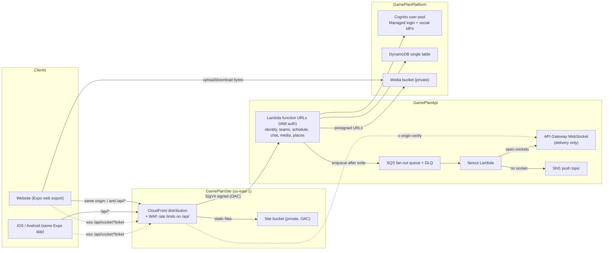

# GamePlan architecture

How GamePlan is put together, and the costs of those choices. Setup and deploy steps are in [`README.md`](README.md).

| | Choice | Main cost |
| --- | --- | --- |
| [Stack](#stack) | TypeScript, one Expo app, Lambda + DynamoDB + Cognito | Generated types, a heavier website, cold starts, Cognito lock-in |
| [HTTP edge](#http-edge) | CloudFront → Lambda function URLs | In-function JWT checks, client body hash, no API Gateway throttle |
| [Realtime](#realtime) | HTTP writes, SQS delivery, push if no socket | Slight delay, at-least-once delivery |
| [Stacks](#stacks-and-accounts) | Four stacks, staging and production in separate accounts | Exports cannot change while another stack imports them |
| [Routes](#routes) | Typed pipeline; the path string is the matcher | A typo in a literal segment is a runtime `404` |
| [Client cache](#client-cache) | TanStack Query, persisted per user | Product data can sit in website storage until sign-out |
| [Hostnames](#hostnames) | One host per environment, API under `/api` | Website and API share cache and error behavior |
| [Certificates](#certificates) | Custom-resource Lambda | More code to own; a failure can stall a deploy for 15 minutes |
| [Security](#security) | Only CloudFront can invoke the API; BFF OAuth | IdP secrets in the template, no MFA, `DESTROY` on stateful resources |

## System overview

The same picture is in [Lucidchart](https://lucid.app/lucidchart/5dd975a6-4a54-4ddd-893c-fae6ea78e583/edit).



Areas are `identity`, `teams`, `schedule`, `chat`, `media`, `places`, `socket`, and `fanout`. Each is one Lambda under `functions/<area>`. Areas do not call each other. They share the DynamoDB table and pass side effects through the fan-out queue.

### Repository layout

| Path | Role |
| --- | --- |
| `lib/schemas` | Zod wire contracts. Source of truth. |
| `lib/types` | Plain TypeScript generated from those schemas, plus domain constants. |
| `lib/rules` | Pure rules shared by the API and the client (roles, minors, search). |
| `lib/pipeline` | Middleware core. No HTTP types. |
| `functions/lib` | Server-only auth, DynamoDB, guards, permissions. |
| `functions/<area>` | One Lambda per area. |
| `client/session` | Refresh and request signing for every platform. |
| `client/expo` | Website and native apps, one Expo Router tree. |
| `infrastructure` | CDK app, four stacks. |
| `local` | Laptop proxy: every area as a process against DynamoDB Local. |

The client and the API meet only through `lib/*`. The client does not import Zod or server code.

## Stack

### TypeScript everywhere

Contracts are written once in Zod, validated on the server, and emitted as plain types by `npm run generate:types`. `npm run typecheck` regenerates them so CI fails on a stale file.

- **Why:** one language, so a contract change breaks both sides in the same build.
- **Cost:** the generated file is committed. A schema edit is not done until regeneration is committed too.

A bounded array (`.max(n)`) becomes `T[]` in the generated types (`maxItems: -1`), and a non-empty one `[T, ...T[]]`. Writing out every allowed length as a tuple made callers cast; the server still enforces the limit.

### One Expo app

One Expo Router app is the website (static export) and the store apps. Maps, the day field, and the time clock use `.native.tsx` files.

- **Why:** three platforms, one set of screens.
- **Cost:** the website carries React Native Web, which is heavier than a web-only app. Maps and push need a separate web path.

### Lambda, DynamoDB, Cognito

- **Lambda per area.** Node.js 22, ARM64, 512 MB. Each area scales, deploys, and holds IAM on its own. Its bundle contains only its routes. Graviton is cheaper per millisecond than x86, and these functions mostly wait on AWS calls, so the lower rate is nearly all savings.
- **One DynamoDB table, on demand.** Access starts at a partition (`USER#`, `TEAM#`, `CHAT#`, `INVITE#`, `TICKET#`, `HANDOFF#`). Two indexes exist, both keys-only: exact email (`EmailIndex`) and socket lookup by connection id (`ConnectionIndex`). Socket rows expire through `ttl`.
- **Cognito Managed login** covers email and password, verification, and optional Google, Apple, and Facebook. No auth server to run.
- **No VPC.** Nothing needs a private network, so there is no ENI on cold start and no NAT.

- **Why:** weekend traffic can scale to zero. A query is one round trip when it starts at a partition.
- **Cost:** cold starts, and per-request pricing can pass a small always-on container under steady load. A query that cannot start at a partition needs a new index or a copied row. Cognito password hashes cannot be exported, and Managed login styling is limited.

### Shared games

Each club keeps its own event for RSVP, lineup, carpool, title, and notes. Once linked, start, venue, and the two names live on one fixture row. Until then the opponent is a name and a home or away side, so the away club can put the game on its calendar first. A recurring event cannot be shared. If both clubs have a sport set and they differ, the link is rejected.

- **Why:** calendars must not diverge on time and place, and a club should not wait for the other to file the game.
- **Cost:** a linked event cannot change those shared fields on its own row. Edits go through the fixture and fan out `event_moved` to both rosters. Unlink copies the last facts back onto each event and keeps both games.

The fixture thread is a `fixture` chat. Members are whoever holds `manage_events` on either club, including after a role or matrix change. Players and parents without that grant are not members.

### Recurring events

A series is one row with a structured rule (`frequency`, `interval`, `byWeekDay`, `until`, `count`). `expandOccurrenceStarts` (`functions/lib/expand-occurrences.ts`) runs the rule on the team's wall clock: it converts the start to local time (`toWallClock` in `functions/lib/time-zone.ts`), expands with `rrule`, and converts each result back to UTC. Every caller passes the team's `timeZone`. One helper, `assertLiveOccurrence`, checks that an RSVP, lineup, or carpool instant is a real, uncancelled date.

- **Why:** `BYDAY` codes come from the local calendar day, and "Tuesdays at 7 pm" means 7 pm on the wall. Expanding in UTC put Pacific evening practices on Mondays and moved them an hour at each daylight-saving change.
- **Cost:** a one-date check reads the team row for its zone. Changing a team's time zone moves every future occurrence. Rows keyed by an instant the old UTC expansion produced (RSVPs, exdates, split-off dates on shifted dates) no longer match a date; this landed before launch, so nothing was migrated.

### Reminder times

Each person picks an evening-before hour (5–9 pm, team time) and a lead time (15 minutes to 2 hours), or turns either off. Settings live at `USER#<id>` / `PREFS` (`functions/lib/preferences.ts`); a missing row means 6 pm and one hour. Reminder rows stay shared per occurrence: every allowed time gets a row (`evening18`, `before60`, ...), and when one comes due the sweep sends it to RSVPs going or maybe whose choice matches (`wantsSlot`). The last time of a date (`before15`) writes the next date's rows. Rows and jobs from before the change (`kind: 'hour'`) still send and chain.

- **Why:** rows scale with events, not people, and a choice change needs no rewrite of any row. A fixed menu keeps that row count small.
- **Cost:** nine rows per upcoming occurrence instead of two, and one preferences read per recipient at send time. `deleteRemindersForEvent` scans the whole `REMINDERS` partition, which is now larger; a per-event pointer would fix that when it matters. Nobody can pick a time off the menu.

### Calendar sync

Each person gets a private iCalendar link (`GET /schedule/feed`), created on first request. `USER#<id>` / `FEED` holds a 192-bit random token and `FEED#<token>` maps it back. Calendar apps fetch `GET /schedule/feeds/<token>.ics` with no sign-in; the token is the only check, like a share link, and **Reset link** (`POST /schedule/feed/rotate`) replaces it. The feed covers the person's teams and their children's teams (`listChildIds`), 30 days back to 180 days ahead, up to 20 teams, through the same `listOccurrences` as the app. The app offers Google, Apple, and Outlook subscribe links (`client/expo/src/calendar-links.ts`) and asks for the link only after a tap, so viewing the profile creates no token.

Each date is its own `VEVENT` with a UTC start and a stable UID (`<team>-<event>-<start>@gameplan`), not a repeat rule (`functions/schedule/src/ical.ts`). The body says to refresh hourly; responses may be cached for 15 minutes.

- **Why:** calendar apps cannot sign in. Single events avoid differences in how apps read repeat rules, exceptions, and time zones; a cancelled or moved date just changes on the next fetch. A UID per date keeps an edited date the same event in the calendar.
- **Cost:** anyone holding the link sees that schedule, including children's; the app says so next to the link. Google refreshes on its own schedule, often every 8 to 24 hours, so changes are slow to appear there. Each fetch reads every team's events and RSVPs for about seven months.

### Emergency and medical info

One record per person at `USER#<id>` / `MEDICAL` (`functions/lib/medical.ts`): allergies, conditions, medications, insurance, notes, and up to four contacts, phones stored in E.164. It follows the person, not a team. An adult keeps their own; a minor's guardians keep theirs, and the minor can read it (`canEditMedicalInfo`, `canReadOwnMedicalInfo` in `lib/rules`). `GET /identity/medical` returns the caller and each linked child, which is also how the app learns who a guardian's children are.

Staff read through a team: `GET /teams/:teamId/members/:userId/medical` needs `view_medical_info` and an adult caller, and returns the record plus the member's guardians' names and phones. New teams give coaches that permission. Every read writes `MEDREAD#<at>#<viewer>#<member>` on the team, expiring after a year. The app loads it only on a tap, and neither query is persisted to the device.

- **Why:** a parent fills it in once for every team. Guardians are the first people to call, so they come from the existing links rather than being typed again. Staff opening it on purpose, and the log, make access deliberate and reviewable.
- **Cost:** it is free on every plan, by design. Teams created before this keep their stored permission matrix, so their admins grant `view_medical_info` to coaches by hand. There is no screen for the read log yet; it is in the table. A minor in a coach role cannot read it even with the permission.

### Volunteer sign-ups

Staff with `manage_events` add slots to one occurrence ("Snacks, 1", "Drivers, 3"); any member takes or gives up a place. All slots of an occurrence share one row, `SIGNUPS#<occurrence>#<eventId>`, like carpools. Replacing the list keeps the people on slots that stay and refuses to shrink a slot below them. A guardian may sign up a child; staff may remove anyone. People on a slot, and whoever signed them up, get the event's reminders without an RSVP. Each change sends `signups_changed` over the socket (no push).

- **Why:** one read shows the whole occurrence, and every write is conditional on the row's `version`, so two parents taking the last place at once cannot both get it; the loser sees `condition_failed` and retries. Unlike carpool seats, claims are not queued offline, since a claim replayed hours later could take a place that is gone.
- **Cost:** concurrent edits to different slots of one occurrence also collide and one retries. The app signs up the caller only; the guardian-for-child path is in the API, not yet a screen.

### Polls in chat

A poll is a chat message with a `poll` field, and its body is the question, so it pages, previews, and pushes like any message. Creating one also writes `CHAT#<chatId>` / `POLL#<messageId>` so a vote can find the poll by id (message rows are keyed by time). Each person's choice is its own row, `VOTE#<messageId>#<userId>`; an empty choice deletes it. History adds a `pollTally` (counts, voters, the reader's own choices) to poll messages, and each vote sends `poll_updated` with the new counts to the chat's open sockets (no push). Options get short ids (`o1`, `o2`, ...), a poll may allow several answers, and a close time stops votes.

- **Why:** a vote row per person means voters never collide and never rewrite the message, and changing a vote is one put. Counting on read keeps one source of truth.
- **Cost:** each poll message on a page costs a query for its votes. A live update carries counts only, so the reader's own choices come from their vote response or the next history load. Votes are visible as counts, not names.

### Organizations

An organization is one club or league over many teams (`functions/orgs`). Its rows live under `ORG#<orgId>`: `META` (name, owner), `ADMIN#<userId>`, `TEAM#<teamId>` (`pending` until accepted), `PLAN`, and `BILLING`. A team points back with `TEAM#<teamId>` / `ORG`, and `USER#<userId>` / `ORG#<orgId>` lists what someone administers. Only adults own or administer one; only the owner adds admins and manages billing.

An admin invites a team; it joins when someone with the team's `manage_billing` accepts, and either side can end it. A team paying for its own plan keeps it while the organization is unpaid. Once the organization's plan is active (on joining a paid organization, or when an organization subscribes with teams already in it), the team's own subscription is cancelled with the unused time refunded to the card (`cancelOwnTeamPlan`): Stripe credits a prorated cancellation to the customer balance, so the credit is refunded against the latest paid invoice and the balance zeroed, and the team's plan row is marked cancelled at once so a webhook retry cannot cancel twice. On joining, the cancel runs before the join is written; if Stripe fails, the team stays out and accepting again retries. In the webhook, every team is tried and the first failure makes Stripe retry. The organization's plan is copied only while it is active, so a lapsed organization never overwrites a team's own plan. Leaving a paid organization puts the team on the free plan.

`requireMembership` treats an admin of the team's organization as `team_admin` on that team, without a roster row. The check runs only when the caller has no roster row, so members pay nothing extra, and every existing team route works for organization admins unchanged. They are not added to chats.

The organization plan is a Stripe subscription with two items: the base price (`org_monthly` / `org_yearly`, five teams included) and an extra-team item (`org_extra_team_monthly` / `_yearly`) whose quantity is teams past five. `syncOrgSeats` sets that quantity whenever a team joins or leaves and after checkout. The plan is written to `ORG#` / `PLAN` and copied onto each member team's `PLAN` row with `orgId`; a team's own subscription never overwrites a copy, and leaving deletes it. Announcements (`POST /orgs/:orgId/announcements`) post one message, prefixed with the organization's name, to each team's main chat, and need the organization plan; creating an organization and adding teams are free.

- **Why:** the team pointer is its own row because the teams area rewrites `META` whole. Joining gives the organization's admins `team_admin`, so the team's billing manager must agree. Copying the plan keeps a team's entitlement check one read. The guard fallback means no route had to learn about organizations.
In the app, Profile links adults to **Organizations** (`app/(main)/orgs`): the list and create form, and one page per organization with the plan, teams (invited by name through the team directory), admins, and announcements. The team screen shows the team's organization and any invitation, with Join and Decline for its billing manager (`client/expo/src/team-org.tsx`). Organization admins reach member teams from the organization page, since those teams are not in their own team list.

- **Cost:** Stripe requires every item on a subscription to renew on the same interval, so a yearly organization pays extra teams yearly ($60 each) rather than monthly as first planned. A plan change writes every member team's row. Every area that uses `requireMembership` can read `ORG#`. Announcements go out one team at a time from one request, which is fine for dozens of teams and not for thousands.

### Team dues

Each team connects a Stripe Express account. A charge (`TEAM#id` / `CHARGE#`) asks some members to pay; each member's share is a due (`DUE#<chargeId>#<memberId>`) with a pointer on the member's partition for "my dues". Payment is a direct charge on the team's account through hosted Checkout, with GamePlan's cut as `application_fee_amount` (`PLATFORM_FEE_BPS`, default 2%). An adult pays their own due; a minor's guardians pay theirs (`payerIdsForDue` in `lib/rules`). Staff can mark a due paid outside the app or waived.

- **Why:** a direct charge takes Stripe's processing fee from the team's share, so the platform fee arrives whole; a destination charge would make the platform pay processing out of 2%. Hosted Checkout needs no native SDK, gives Apple Pay and Google Pay, and works on the website. Team dues pay for real-world services, so the app stores allow outside payment.
- **Cost:** the team's Stripe account owns refunds and disputes. Stripe returns to a fixed `GET /payments/return` with a target from a closed list (`app` or `web`), never a client URL, so the redirect cannot be abused, at the price of one extra hop.

Due status changes are conditional on a `version` field, so a webhook retry or a race with staff cannot overwrite a newer write. An open checkout is reused rather than starting a second. Every webhook handler is idempotent, and an event applies only to the team whose connected account sent it. A daily sweep reminds payers three days before, on, and weekly after the due date.

The webhook runs as its own function (`payments-webhook`) with a public function URL that serves only `POST /payments/webhook`.

- **Why:** Stripe cannot sign for origin access control, and a function has one function URL. A separate function keeps every other payments route behind the IAM URL.
- **Cost:** that URL skips CloudFront and WAF; the Stripe signature is its only gate.

### Plans and entitlements

Tiers are `free`, `premium` (one team), and `organization` (many teams). Each team has one `TEAM#<teamId>` / `PLAN` row with tier, status, interval, and period end; a team with no row is free. What a tier unlocks (album storage, video, practice plans, waivers, AI requests, organization tools) is one table, `PLAN_LIMITS`, read through `entitlementsFor` in `lib/rules`, so the API and the app enforce the same limits. Prices are not in code; they live in Stripe and the app stores.

Routes gate a feature with `requireEntitlement(feature)` (`functions/lib/entitlements.ts`), listed after `requireMembership`. Count and size limits are checked where an item is added, with `underLimit`. Both fail with `plan_required` or `plan_limit_reached`, which `mapPlanError` turns into `402` for the app's upgrade prompt. Team summaries carry the plan, so screens gate without another request.

A `past_due` plan keeps its tier for seven days after the paid period ends (`effectivePlanTier`). Minors never see ads; an adult sees none once any of their teams is paid or they hold the parent add-on (`showsAds`).

- **Why:** one read per check, and one place to change a limit. An organization's subscription will be copied onto each of its teams' rows rather than looked up through the organization, so a team check stays one read. The plan is its own row, not a field on `META`, because the teams area rewrites `META` whole and a billing write there could be lost.
- **Cost:** team summaries read one more row per team. Copying an organization's plan means its webhook writes every member team's row.

### Subscriptions

Premium and organization plans are Stripe Billing subscriptions on the platform account, sold on the website; the parent add-on goes through Apple and Google in-app purchase. The `billing` area opens Checkout (`POST /billing/teams/:teamId/checkout`, `manage_billing`) and the billing portal for plan changes, cards, cancellation, and invoices. Prices are found by lookup key (`premium_monthly`, `premium_yearly`), so test and live mode run the same code and a price change needs no deploy. Stripe returns to a fixed `GET /billing/return` with a target from a closed list, like dues.

The subscription events are the source of truth for the plan row; checkout completion only records the customer (`TEAM#id` / `BILLING`, plus `STRIPE_CUSTOMER#<id>` to find the team when a subscription has no metadata). A plan write is skipped when the stored row came from a newer Stripe event (`stripeEventCreated`), and every write is conditional on the row's `version`. A first payment still pending (`incomplete`) writes nothing. A team whose plan comes from an organization cannot start its own subscription, and its own subscription events do not overwrite the organization's plan.

The webhook is its own function (`billing-webhook`) with a public URL serving only `POST /billing/webhook`, for the same reason as the dues webhook. It has its own signing secret, because it is a platform endpoint and the dues webhook is a Connect endpoint.

- **Why:** web checkout keeps the stores' 15–30% off team and organization plans, and Stripe hosts the card forms, invoices, tax, and dunning. Ordering by event time makes retries and out-of-order delivery harmless.
- **Cost:** the iOS app may only link out to web checkout where Apple allows it (`EXPO_PUBLIC_IOS_WEB_UPGRADE`); elsewhere it names the website without a price. Two webhook endpoints and secrets to configure.

In the app, `teamEntitlements` (`client/expo/src/plan.ts`) reads the plan off the team summary through the same `entitlementsFor`, and `UpgradeCard` stands in for a feature the plan lacks. The plans screen and team screen open Checkout or the portal with `openStripePage`, which waits for `gameplan://billing`; `app/(main)/billing.tsx` catches that link if the app was closed meanwhile. Plan status is not persisted to device storage, like dues.

- **Cost:** prices on the plans screen are translation copy, so a price change in Stripe also needs a copy change.

## HTTP edge

HTTP is CloudFront → Lambda function URL. There is no API Gateway on that path. WebSocket still uses API Gateway, because function URLs cannot hold connections.

- **Why:** one fewer hop, no API Gateway request charge. CloudFront already terminates TLS, owns the hostname, compresses, and runs WAF.
- **Cost:**
  - No gateway JWT authorizer. Every protected route verifies the Cognito access token in the function (`functions/lib/auth/cognito.ts`).
  - Origin access control signs with SigV4 and does not hash the body. Clients send `x-amz-content-sha256` on writes (`withContentHash` in `client/session`). React Native has no Web Crypto digest, so SHA-256 is plain TypeScript.
  - Origin access control overwrites `Authorization`. A CloudFront Function copies the bearer token into `x-viewer-authorization` before signing.
  - API Gateway throttling and stage tracing are gone. WAF rate-limits. Functions turn on X-Ray themselves.

## Realtime

Clients write messages and RSVPs over HTTP. The area stores the row, then enqueues SQS. Fan-out posts to open sockets. Chat messages and moved events publish to SNS (Web Push or a device token) when no socket accepted the post. Join requests and reminders publish that push as well. A reminder job already lists its recipients, so fan-out delivers to those ids and skips the roster query. A post that reports the connection gone deletes that socket row. A throttled post is queued again for those recipients only, after a short delay, and does not also send a push.

- **Why:** writes stay validated and rate-limited. The socket has no business logic, so a dropped connection does not drop data. The queue retries (dead-letter after five attempts) without holding the write response.
- **Cost:** other users see the change slightly later than a direct broadcast. Delivery is at-least-once, so clients must ignore duplicates.

Events sent while a socket is down are not replayed. Phones drop the socket whenever the screen locks or the app goes to the background, so every reconnect after the first refetches chats, open threads, the schedule, and dues (`resyncAfterReconnect`). The client sends a keepalive frame every four minutes, which keeps API Gateway from closing an idle socket after ten and replaces a socket the phone killed without a `close`. On the website it also reconnects on `pageshow` (Safari's back-forward cache) and `online`.

- **Why:** a catch-up refetch is simpler and cheaper than a replay log, and only on-screen queries refetch.
- **Cost:** each reconnect costs a few reads, and each keepalive invokes the socket function's `$default` route.

A push the service reports gone (Web Push `404`/`410`, Expo `DeviceNotRegistered`) deletes that device row.

### Asking for notifications

Permission is requested only from a tap on the notification banner or the profile button. The banner (`client/expo/src/notification-prompt.tsx`) shows when no choice is recorded; "Not now" hides it for seven days. Each launch re-saves an already-allowed subscription without prompting. iPhone Safari only allows web notifications from the Home Screen, so the site ships a web app manifest and icons, and the banner gives Add to Home Screen steps in a normal tab. A notification tap opens the page the event is about (`public/sw.js`).

- **Why:** Safari ignores a prompt that is not from a tap, and iOS shows its system dialog once, so a sentence of context first protects the one chance.
- **Cost:** people who skip the banner never subscribe until they come back to it.

Locally, chat and schedule `POST` to `/fanout/deliver`.

## Stacks and accounts

`GamePlanDns` → `GamePlanPlatform` → `GamePlanApi` → `GamePlanSite`, wired by CloudFormation exports. Staging and production are the same four stacks in separate accounts. Names stay the same in both.

- **Why:** Cognito, the table, and the media bucket sit in a stack that rarely changes, so an API deploy cannot recreate them. The site stack is last, so it can point at the function URLs. The API stack never points at the distribution, which avoids a cycle. A staging mistake cannot touch production data or IAM.
- **Cost:** CloudFormation will not change an export another stack still imports. A rename is a staged deploy. The certificate export can stay pinned to the previous ARN so an importer does not block the change (see [Certificates](#certificates)).

## Routes

Every HTTP route is `route(method, path, ...steps, handler)` from `functions/lib/pipeline.ts`. The path string is both the URL and the handler fields.

```ts
export const handleSendMessage = route(
  'POST',
  '/chat/:chatId/messages',
  withChatErrors(),
  requireUser(),
  withBodyValidation(sendMessageBodySchema),
  async ({ chatId, user, body }) => { /* ... */ },
);
```

`:chatId` is the field `chatId`. `*objectKey` captures the rest of the path, including slashes, and has to be last. Each area passes its routes to `dispatch`. The route with more literal segments wins, so `/teams/directory` beats `/teams/:teamId`. The same score keeps the earlier route. `GET /health` is answered before that list.

The matcher also accepts the path with the area prefix left off, so `devices/phone` still reaches `/media/devices/:deviceId`. A missing path is treated as `/`.

Steps run in listed order. The first step is the outermost. A step returns a response to stop, or attaches fields and calls `next`. The handler sees every attached field.

- **Order is the source.** Adding a guard is one line. There is no wrapper nesting to unread.
- **The compiler checks dependencies.** A step declares what it needs and what it adds. `requireMembership()` before `user` and `teamId` exist does not compile. Handlers do not write `ctx.user!`.
- **Failures are codes.** Guards throw `not_a_member`, `forbidden`, `team_not_found`. The area's error step is listed first and maps codes to statuses. Business code does not build HTTP responses.
- **Validation is at the edge.** Body and query schemas parse before the handler and return `400 { errors: [{ field, message }] }`. They accept [Standard Schema](https://standardschema.dev); today that is Zod in `lib/schemas`.
- **The core is not HTTP.** `lib/pipeline` is the step type and the compile-time checks. `functions/lib/pipeline.ts` binds Lambda events. The same core could run a queue consumer.

Per request, the chain is one call and one shallow context copy per step. `route` composes the chain at load. There is no router, reflection, or decorator metadata.

Cheap checks are listed first: error mapping, `requireUser` (keys cached after the first verify), body and query parse, then DynamoDB guards. The types enforce data dependencies, not this cheap-to-expensive order, so review has to keep it. `requirePermission` reuses the member from `requireMembership` and only reads the matrix, so a permission check is two table reads.

`logHttpFailure` logs every `4xx` and `5xx`.

- **Why:** the compiler copies parameter names out of the path, so `teamId` in the handler is the `:teamId` segment. No router dependency, and the pattern is split once when the route is created.
- **Cost:** recursive tuple types slow checking a little, and a bad `route` call often reports only the second signature. A typo in a literal segment (`memebrs`) is a runtime `404`. Two patterns that can both match one URL are separated only by the literal-count rule.

### Warm state

The DynamoDB client, the Cognito verifier (and its JWKS), and a five-minute Parameter Store cache are created on first use and reused. Tests reset them with `resetDocClient`, `resetAccessVerifier`, and `resetParameterCache`.

## Client cache

Screens load through TanStack Query. Keys, query functions, and cache writes live in `client/expo/src/queries/`. Screens do not fetch in `useEffect`.

- **Defaults.** `createQueryClient` reuses a value for 30 seconds and retries only `TypeError` or `http_5xx`, at most twice. `queryKeys` is the only place a cache entry is named.
- **Permissions.** `useTeamAccess` reads `permissionsQuery` for 60 seconds. A save writes the returned rows back. The check is `canWithRoles` from `lib/rules`, the same function as `requirePermission`.
- **Live events.** The signed-in shell prepends `chat_message` onto a thread that is already loaded, skips duplicates, and does not invent a one-message page. Schedule and join-request events invalidate that team's prefix.
- **Pull to refresh.** The shell refetches every query a mounted screen is subscribed to. It does not keep a list of keys. A value that is only in the cache, with no subscriber, stays put. A screen still mounted underneath the visible one reloads too.
- **Offline writes.** Most mutations use `networkMode: 'always'` and fail immediately offline. RSVP, carpool, and lineup use `online`, pause while disconnected, and resume after relaunch. Chat sends are not queued.
- **Connectivity.** Unknown NetInfo (`null`) counts as online so launch does not flash offline. Only a definite `false` pauses. On iOS and Android, returning to the foreground refetches stale queries and reconnects the socket. The website uses `visibilitychange`.
- **Persistence.** Successful queries of known kinds (profile, teams, roster, permissions, schedule, chat list) stay in AsyncStorage for 24 hours. Presigned URLs, message history, directory pages, and invite previews are left out. The refresh token stays in SecureStore or the HttpOnly cookie. Restore waits until the session user is known and uses that id as the persist buster, so another account's data is discarded. Sign-out clears memory and storage.
- **Calendar and brand.** The schedule merges every membership for the visible month in the device time zone. Each event type has one fixed color (`EVENT_TYPE_COLORS` in `client/expo/src/theme.ts`): the stripe on its row, the dot beside its label, the picker, and the calendar's day dots, one per type present that day. Fixed rather than team colors, so a type reads the same across teams; the team is shown by name and logo instead. The colors avoid the brand green and error red and keep 3:1 contrast on the row and card backgrounds (checked in `theme.test.ts`). One membership brands the shell. Several memberships stay on the default colors until the athlete opens a team, event, or chat. There is no team switcher. A carpool claim opens one private chat for that car; later riders join it; an empty car deletes it. A minor rider's guardian is added.

- **Cost:** AsyncStorage is `localStorage` on the website, so roster and schedule can remain on disk until sign-out. That is product data, not tokens.
- **Open:** chat history is one page, and an offline send is not replayed. `useInfiniteQuery` (already used for directory search) and a persisted send would close that without a new cache.

## Hostnames

Each environment is `<environment>.<domain>`, for example `staging.example.com`. The website and the API share it. The API is `/api/<area>`.

An earlier design used a separate `api.` host, its own distribution, and its own certificate.

- **Why this host:** same origin, so authenticated JSON does not pay a CORS preflight. That round trip matters on mobile networks. The refresh cookie is `SameSite=Lax` and scoped to `/api/identity`, with no cross-site cookie rules. One certificate, one distribution, one WAF.
- **Cost:** cache behavior must split website routes (which rewrite to `index.html`) from API paths. There are no distribution-wide error pages, because they would turn API `403` and `404` into HTML.

The socket is `wss://<host>/api/socket`. CloudFront forwards the upgrade, so connects pass the same WAF (WAF cannot attach to a WebSocket API directly) and skip a second DNS lookup and TLS handshake.

- **Cost:** one more CloudFront behavior, and a shared origin secret (see [Security](#security)).

## Certificates

`GamePlanDns` uses a custom-resource Lambda (`infrastructure/lib/dns-handler.ts`) to request the ACM certificate and write validation and alias records.

- **Why:** the hosted zone may be in another account. The handler assumes a role there for Route 53 and keeps the certificate in this account. On a hostname change it issues the new certificate before CloudFront drops the old one, then deletes the stale alias. Built-in constructs replace the certificate in place and break the live distribution. The handler can keep returning the previous ARN on an existing export so an importing stack does not block the deploy. CloudFront requires the certificate in `us-east-1`.
- **Cost:** more code to own and test than a one-line construct. A failed custom resource can leave CloudFormation waiting until its 15-minute timeout.

## Configuration

Hand-set inputs (hosted zone, IdP credentials, map keys, VAPID keys, the staging signup allowlist) live in Parameter Store under `/gameplan/`. String and SecureString both decrypt on read. Stack outputs are not written back. The deploy workflow reads them from the `cdk deploy --outputs-file` JSON, so a parameter cannot keep a stale value from an older deploy.

Secret values themselves are covered under [Secrets at run time](#secrets-at-run-time).

## Bundle size and latency

### API

- One esbuild bundle per area. `npm run inspect:api` prints sizes. `places` does not carry chat code.
- ESM, minified, Node 22. A `createRequire` banner covers dependencies that still call `require`.
- `sideEffects: false` on `lib/schemas`. Without it, fan-out shipped a phone-number library it never called.
- No source maps in the deployed bundle. A 1.1 MB map was shipping for no runtime benefit.
- AWS SDK v3 clients, created on first use and reused while the container is warm.
- Writes return when the DynamoDB row is stored. Fan-out is later, on SQS.
- File bytes never enter Lambda. `media` returns presigned S3 URLs (15 MB cap, 15-minute download).
- A recurring event is stored once and expanded for the requested window, capped at about three months.

**Open:** measure p95 cold start per area. If identity or chat cold starts hurt sign-in or sending, try provisioned concurrency on those functions only, or more memory (more memory is also more CPU during init). Everything is in `us-east-1`. Users far from Virginia pay that round trip on every call. Multi-region is a large change and only worth real demand.

### Client

- The client never ships Zod. The Docker image does not install `lib/schemas`.
- `.native.tsx` keeps `react-native-maps` and the native date picker out of the web bundle. The web map injects the Maps script only when a map is shown. `expo-notifications` loads when push registration runs.
- `GET /teams/:teamId/members` returns photo key, positions, and phone (a minor's phone only for that minor and their guardians), so an event is one roster read.
- Web routes are `asyncRoutes`. The first visit downloads the shell plus the current route. Native production stays eager so a store build does not suspend on navigation. `npm run inspect:client` lists the export.

**Open:** the deploy syncs the site with no `Cache-Control`, then invalidates `/*`. Hashed assets should be `public, max-age=31536000, immutable` and `index.html` `no-cache`. `"output": "static"` would prerender login HTML, once every screen can render without `window`. Both `en.json` and `es.json` ship in the main bundle.

### Edge

HTTP/2 and HTTP/3, compression on. Static files use `CACHING_OPTIMIZED`. `/api` is not cached. The SPA rewrite is a CloudFront Function at the viewer, cheaper than Lambda@Edge or an S3 error-page round trip. `PRICE_CLASS_100` keeps edges in North America and Europe. Users elsewhere connect farther away.

## Security

### Only CloudFront can reach the API

- Function URLs use `AWS_IAM`. The site stack grants `lambda:InvokeFunctionUrl` and `lambda:InvokeFunction` to the CloudFront service principal, scoped to this distribution's ARN. A direct call to a function URL fails, so HTTP passes WAF.
- The site bucket blocks public access and is reachable only through origin access control.
- TLS 1.2 minimum (`TLS_V1_2_2021`). HTTP redirects to HTTPS.
- Website responses: HSTS (one year, subdomains, preload), `X-Content-Type-Options: nosniff`, `X-Frame-Options: DENY`, `Referrer-Policy: strict-origin-when-cross-origin`.
- **Content-Security-Policy** (`infrastructure/lib/website.ts`). Scripts may come only from this origin and Google Maps, with no `'unsafe-inline'` or `'unsafe-eval'`. Network calls may go only to this origin (including `wss:`), the media bucket, and Google Maps. `object-src 'none'`, `base-uri 'self'`, and `frame-ancestors 'none'`. Styles do allow `'unsafe-inline'`, because react-native-web injects style tags and the Expo export inlines a reset. The access token lives in page memory, so an injected script could read it. Inline styles are a smaller hole than inline scripts. Moving styles to nonces needs control of how react-native-web injects them.
- The viewer function overwrites or deletes `x-viewer-authorization`, so a client cannot forge it.
- CloudFront adds `x-origin-verify` (the `socket-origin-verify` parameter) to every socket connect. The `$connect` authorizer requires it and compares in constant time before spending the ticket. API Gateway returns `401` for a direct `execute-api` connect. Authorizer caching is off so a cached allow cannot replay a ticket.

### Rate limits

WAF on `/api/`, six rules, each a five-minute window, `429` with `{"error":"rate_limited"}`. Static files are outside the rules. WAF is pay-as-you-go, because a CloudFront flat-rate plan cannot key a rate rule on a header.

| Rule | Key | Limit | Purpose |
| --- | --- | --- | --- |
| `PerAccessToken` | `Authorization` | 600 | Fairness for signed-in traffic. |
| `PerAnonymousIp` | IP, no token | 100 | Slows stuffing and signup abuse on open identity routes. |
| `SocketConnectIp` | IP, `/api/socket` | 1000 | Caps connect floods. Reconnects would burn the anonymous limit. |
| `PerIpFlood` | IP | 4000 | Stops a client that invents a new `Authorization` per request, without blocking a club behind one NAT. |
| `PerCalendarFeed` | URI path, `/api/schedule/feeds/` | 30 | Stops one leaked feed link from being hammered. |
| `CalendarFeedIp` | IP, `/api/schedule/feeds/` | 20000 | Google and Outlook fetch every subscriber's feed from a few shared addresses, so feeds sit outside the anonymous and flood rules. |

- **Cost:** the token rule keys on the raw header, including tokens that are not verified yet. The flood rule bounds that. A verified-user limit would have to run inside the function.

### Sessions

- **Backend-for-frontend OAuth.** The app never calls Cognito's token endpoint. `identity` runs the code flow with PKCE and exchanges the code. The app client has no secret (`generateSecret: false`). `preventUserExistenceErrors` is on.
- **Access token in memory.** The website does not put it in `localStorage`.
- **Website refresh** is an HttpOnly cookie (`ts_refresh`, `Secure` in production, `SameSite=Lax`, path `/api/identity`).
- **Native refresh** is Expo SecureStore, requested with `X-Refresh-Delivery: body`. The system browser cannot share cookies with the app, so the callback stores the refresh token under a random 32-byte code for 60 seconds and redirects to `gameplan://auth?code=…`. Redeeming it is a conditional delete. An expired row is rejected even if TTL has not removed it.
- **One refresh in flight.** `SessionService.refresh()` shares one `POST /identity/refresh` across the shell, session restore, and every `401`. A finished attempt clears the promise. TanStack does not retry `unauthorized`.
- **Refresh on the next request.** `expiresIn` becomes an in-memory `expiresAt`. The next product call refreshes when the token would expire within five minutes. Idle tabs do not run a timer. A `401` is the backstop. Boot paths use `ensureSession()`, which skips identity when a fresh token is already in memory, so a full page load does not refresh twice.
- **Socket ticket.** A browser WebSocket cannot set `Authorization`, and a token in the URL would land in access logs. `POST /identity/socket-ticket` returns a one-time 60-second ticket. `$connect` redeems it with the same conditional delete.
- **Staging signups** are an allowlist in Parameter Store, read by a pre-signup Lambda.

### Authorization

- Every protected route checks the Cognito access token (signature, issuer, client id, `token_use=access`) with `aws-jwt-verify`. Missing Cognito settings reject every token. Local HS256 needs `AUTH_PROVIDER=local` and `LOCAL_JWT_SECRET`, and is refused when `NODE_ENV=production`.
- Team permissions are data. The matrix (`manage_events`, `invite_members`, `assign_roles`, and the rest) is loaded by `requireMembership` and `requirePermission` before the handler.
- Minor rules in `lib/rules` are enforced on the server. A minor cannot create a team, be `team_admin`, or hold `manage_permissions`. A minor's chat is limited to shared teammates and linked guardians. Search returns adults only, and only on an exact email.
- Media downloads check context. Own uploads match a key prefix. Anything else requires the chat, team, or profile, and membership there.

### Least-privilege IAM

Each area's role is limited to the DynamoDB prefixes it uses, via `dynamodb:LeadingKeys` (`infrastructure/lib/table-access.ts`). `places` has no table access. `schedule` can touch `TEAM#`, `REMINDERS`, and the `CHAT#` / `USER#` rows for a carpool chat. `fanout` reads those prefixes and may delete a `USER#` item after a socket or push device is reported gone. `payments` writes `TEAM#`, `USER#`, `STRIPE_ACCOUNT#`, and `PAYMENT_REMINDERS`; its webhook function writes only `TEAM#` and `STRIPE_ACCOUNT#`. `billing` and its webhook write only `TEAM#`, `ORG#`, and `STRIPE_CUSTOMER#`. `orgs` writes `ORG#`, `TEAM#`, `USER#`, and `CHAT#` (announcements); every area with the membership guard reads `ORG#`. Identity and Access Management cannot limit that delete to the `CONN#` sort key; the function only deletes the connection id from the failed post. `ForAllValues` stops a transaction from mixing in another prefix. Identity may call `AdminGetUser` and `AdminDeleteUser` (to replace an unconfirmed signup). CI uses GitHub OIDC (`AWS_ROLE_ARN` per environment). Deploy logs are redacted.

Buckets block public access, use S3-managed encryption, and require TLS. Media CORS allows only the website origin. SQS uses SQS-managed encryption.

### Secrets at run time

Secret values are not Lambda environment variables. `lambda:GetFunctionConfiguration` can read those in plain text, published versions keep them, and a log of `process.env` would leak them.

A function receives the parameter name and reads the value through `readSecret` (`functions/lib/parameters.ts`).

| Secret | Function | Parameter |
| --- | --- | --- |
| Google Maps server key | places | `<prefix>/google-maps-api-key` |
| VAPID private key | fanout | `<prefix>/vapid-private-key` |
| Socket origin secret | socket authorizer | `<prefix>/socket-origin-verify` |
| Stripe secret key | payments, payments-webhook | `<prefix>/stripe-secret-key` |
| Stripe webhook signing secret | payments, payments-webhook | `<prefix>/stripe-webhook-secret` |
| Stripe Billing webhook signing secret | billing-webhook | `<prefix>/stripe-billing-webhook-secret` |

- Each role has `ssm:GetParameter` on its own parameter. The origin secret is a random String set by hand. CloudFront needs the literal value, so it cannot be a SecureString. The site stack resolves it at deploy time for the header.
- Values stay in memory for five minutes. A rotation is picked up without a deploy. A failed read is not cached.
- A missing parameter means not configured. Places returns `503`, fan-out skips web push, and the authorizer rejects every connect.
- On the laptop, a function with no parameter name reads the plain variable (`GOOGLE_MAPS_API_KEY`). That path is ignored when `NODE_ENV=production`.
- **Cost:** one Parameter Store read per warm container every five minutes.

The VAPID public key and subject are not secret and stay in the environment.

Other Parameter Store inputs (zone, IdP credentials, browser map key, VAPID public values, staging allowlist) are listed in the deploy configuration. An IdP is created only when every field for that provider is set. CDK context overrides those values for a local `cdk deploy`.

### Gaps

- **IdP secrets pass through the template** via `SecretValue.unsafePlainText`, so they appear in the synthesized template. Several parameters are still `String`. Run-time reads already decrypt, so switching one to `SecureString` needs no code change. The origin secret cannot move, because CloudFront needs the literal.
- **The origin secret is readable** by `cloudfront:GetDistributionConfig` or `ssm:GetParameter`. Leaking it only skips WAF. A ticket is still required. Rotation is a new value plus a site deploy. The authorizer's five-minute cache means connects can fail in between.
- **Stateful resources use `RemovalPolicy.DESTROY`.** The user pool, table, and media bucket die with the stack. The table has no point-in-time recovery. Convenient for staging, dangerous for production. Production should use `RETAIN` and PITR.
- **No MFA, 8-character password minimum.** Optional TOTP for team admins and a longer minimum are cheap later.
- **First deploy socket gap.** `cdk deploy --all` updates the API before the site. For a few minutes the authorizer requires `x-origin-verify` and the distribution does not send it yet.
- **Old native builds** still dial `execute-api` and lose live delivery until rebuilt against `wss://<site host>/api/socket`. Writes and push still work.

## Local development

`local` runs every area as its own process behind a proxy on port 3000, against DynamoDB Local. Handlers are the Lambda code. Compose signs in through a deployed Cognito pool. Offline work sets `AUTH_PROVIDER=local` and `LOCAL_JWT_SECRET`. That mode never runs in production.

- **Why:** breakpoints in every area, and no shared dev account.
- **Cost:** local mode skips CloudFront, origin access control, WAF, and IAM. Body hashing, header rewriting, and rate limits are exercised in staging. `infrastructure/lib/*.test.ts` synthesizes the stacks and asserts those pieces.
