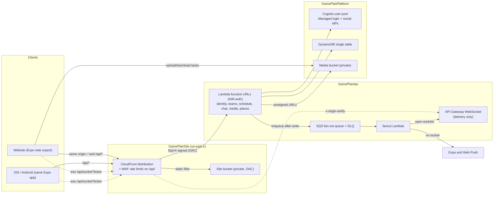

# GamePlan architecture

How GamePlan is put together, and the costs of those choices. Setup and deploy steps are in [`README.md`](../README.md).

| | Choice | Main cost |
| --- | --- | --- |
| [Stack](#stack) | TypeScript, one Expo app, Lambda + DynamoDB + Cognito | Generated types, a heavier website, cold starts, Cognito lock-in |
| [HTTP API](api.md) | CloudFront → Lambda function URLs, typed routes | In-function JWT, body hash, WAF not API Gateway throttle |
| [Realtime](realtime.md) | HTTP writes, SQS delivery, push if no socket | Slight delay, at-least-once delivery |
| [Stacks](#stacks-and-accounts) | Four stacks, staging and production in separate accounts | Exports cannot change while another stack imports them |
| [Client](client.md) | One Expo app, TanStack Query | Heavier web bundle; cached product data until sign-out |
| [DNS and hosting](dns-and-hosting.md) | One host per environment, CloudFront + ACM | SPA vs `/api` cache split; custom-resource certs |
| [Configuration](configuration.md) | Parameter Store + CDK outputs per deploy | Outputs are not written back to SSM |
| [Security](security.md) | Edge, auth, IAM, CSP, known gaps | Stripe webhooks and calendar tokens are special cases |

## Contents

- [System overview](#system-overview)
  - [Repository layout](#repository-layout)
- [Stack](#stack)
  - [TypeScript everywhere](#typescript-everywhere)
  - [One Expo app](#one-expo-app)
  - [Lambda, DynamoDB, Cognito](#lambda-dynamodb-cognito)
  - [Shared games](#shared-games)
  - [Recurring events](#recurring-events)
  - [Reminder times](#reminder-times)
  - [Calendar sync](#calendar-sync)
  - [Emergency and medical info](#emergency-and-medical-info)
  - [Volunteer sign-ups](#volunteer-sign-ups)
  - [Invites sent by GamePlan](#invites-sent-by-gameplan)
  - [Polls in chat](#polls-in-chat)
  - [Organizations](#organizations)
  - [Team dues](#team-dues)
  - [Plans and entitlements](#plans-and-entitlements)
  - [Team album](#team-album)
  - [Waivers](#waivers)
  - [Stripe (dues, subscriptions, Terraform)](stripe.md)
- [HTTP API](api.md)
- [Realtime](realtime.md)
- [Stacks and accounts](#stacks-and-accounts)
- [Client](client.md)
- [DNS and hosting](dns-and-hosting.md)
- [Configuration](configuration.md)
- [Security](security.md)

## System overview

The same picture is in [Lucidchart](https://lucid.app/lucidchart/5dd975a6-4a54-4ddd-893c-fae6ea78e583/edit).

Areas include `identity`, `teams`, `schedule`, `chat`, `media`, `places`, `payments`, `billing`, `orgs`, `socket`, and `fanout`. Each is one Lambda under `functions/<area>`. HTTP routing, auth, and edge behavior: [`api.md`](api.md).

### Repository layout

| Path | Role |
| --- | --- |
| `lib/schemas` | Zod wire contracts. Source of truth. |
| `lib/types` | Plain TypeScript generated from those schemas, plus domain constants. |
| `lib/rules` | Pure rules shared by the API and the client (roles, minors, search). |
| `lib/pipeline` | Middleware core. No HTTP types. |
| `functions/lib` | Server-only auth, DynamoDB, guards, permissions. |
| `functions/<area>` | One Lambda per area. |
| `client/session` | Refresh and request signing for every platform. |
| `client/expo` | Website and native apps, one Expo Router tree. |
| `infrastructure` | CDK app, four stacks. |
| `local` | Laptop proxy: every area as a process against DynamoDB Local. |

The client and the API meet only through `lib/*`. The client does not import Zod or server code.

## Stack

### TypeScript everywhere

Contracts are written once in Zod, validated on the server, and emitted as plain types by `npm run generate:types`. `npm run typecheck` regenerates them so CI fails on a stale file.

- **Why:** one language, so a contract change breaks both sides in the same build.
- **Cost:** the generated file is committed. A schema edit is not done until regeneration is committed too.

A bounded array (`.max(n)`) becomes `T[]` in the generated types (`maxItems: -1`), and a non-empty one `[T, ...T[]]`. Writing out every allowed length as a tuple made callers cast; the server still enforces the limit.

### One Expo app

One Expo Router app is the website and the store apps. Structure, cache, and bundle trade-offs: [`client.md`](client.md).

### Lambda, DynamoDB, Cognito

- **Lambda per area.** Node.js 22, ARM64, 512 MB. Each area scales, deploys, and holds IAM on its own. Its bundle contains only its routes. Graviton is cheaper per millisecond than x86, and these functions mostly wait on AWS calls, so the lower rate is nearly all savings.
- **One DynamoDB table, on demand.** Access starts at a partition (`USER#`, `TEAM#`, `CHAT#`, `INVITE#`, `TICKET#`, `HANDOFF#`). Two indexes exist, both keys-only: exact email (`EmailIndex`) and socket lookup by connection id (`ConnectionIndex`). Socket rows expire through `ttl`.
- **Cognito Managed login** covers email and password, verification, and optional Google, Apple, and Facebook. No auth server to run.
- **No VPC.** Nothing needs a private network, so there is no ENI on cold start and no NAT.

- **Why:** weekend traffic can scale to zero. A query is one round trip when it starts at a partition.
- **Cost:** cold starts, and per-request pricing can pass a small always-on container under steady load. A query that cannot start at a partition needs a new index or a copied row. Cognito password hashes cannot be exported, and Managed login styling is limited.

### Shared games

Each club keeps its own event for RSVP, lineup, carpool, title, and notes. Once linked, start, venue, and the two names live on one fixture row. Until then the opponent is a name and a home or away side, so the away club can put the game on its calendar first. A recurring event cannot be shared. If both clubs have a sport set and they differ, the link is rejected.

- **Why:** calendars must not diverge on time and place, and a club should not wait for the other to file the game.
- **Cost:** a linked event cannot change those shared fields on its own row. Edits go through the fixture and fan out `event_moved` to both rosters. Unlink copies the last facts back onto each event and keeps both games.

The fixture thread is a `fixture` chat. Members are whoever holds `manage_events` on either club, including after a role or matrix change. Players and parents without that grant are not members.

### Recurring events

A series is one row with a structured rule (`frequency`, `interval`, `byWeekDay`, `until`, `count`). `expandOccurrenceStarts` (`functions/lib/expand-occurrences.ts`) runs the rule on the team's wall clock: it converts the start to local time (`toWallClock` in `functions/lib/time-zone.ts`), expands with `rrule`, and converts each result back to UTC. Every caller passes the team's `timeZone`. One helper, `assertLiveOccurrence`, checks that an RSVP, lineup, or carpool instant is a real, uncancelled date.

- **Why:** `BYDAY` codes come from the local calendar day, and "Tuesdays at 7 pm" means 7 pm on the wall. Expanding in UTC put Pacific evening practices on Mondays and moved them an hour at each daylight-saving change.
- **Cost:** a one-date check reads the team row for its zone. Changing a team's time zone moves every future occurrence. Rows keyed by an instant the old UTC expansion produced (RSVPs, exdates, split-off dates on shifted dates) no longer match a date; this landed before launch, so nothing was migrated.

### Reminder times

Each person picks an evening-before hour (5–9 pm, team time) and a lead time (15 minutes to 2 hours), or turns either off. Settings live at `USER#<id>` / `PREFS` (`functions/lib/preferences.ts`); a missing row means 6 pm and one hour. Reminder rows stay shared per occurrence: every allowed time gets a row (`evening18`, `before60`, ...), and when one comes due the sweep sends it to RSVPs going or maybe whose choice matches (`wantsSlot`). The last time of a date (`before15`) writes the next date's rows. Rows and jobs from before the change (`kind: 'hour'`) still send and chain.

- **Why:** rows scale with events, not people, and a choice change needs no rewrite of any row. A fixed menu keeps that row count small.
- **Cost:** nine rows per upcoming occurrence instead of two, and one preferences read per recipient at send time. `deleteRemindersForEvent` scans the whole `REMINDERS` partition, which is now larger; a per-event pointer would fix that when it matters. Nobody can pick a time off the menu.

### Calendar sync

Each person gets a private iCalendar link (`GET /schedule/feed`), created on first request. `USER#<id>` / `FEED` holds a 192-bit random token and `FEED#<token>` maps it back. Calendar apps fetch `GET /schedule/feeds/<token>.ics` with no sign-in; the token is the only check, like a share link, and **Reset link** (`POST /schedule/feed/rotate`) replaces it. The feed covers the person's teams and their children's teams (`listChildIds`), 30 days back to 180 days ahead, up to 20 teams, through the same `listOccurrences` as the app. The app offers Google, Apple, and Outlook subscribe links (`client/expo/src/calendar-links.ts`) and asks for the link only after a tap, so viewing the profile creates no token.

Each date is its own `VEVENT` with a UTC start and a stable UID (`<team>-<event>-<start>@gameplan`), not a repeat rule (`functions/schedule/src/ical.ts`). The body says to refresh hourly; responses may be cached for 15 minutes.

- **Why:** calendar apps cannot sign in. Single events avoid differences in how apps read repeat rules, exceptions, and time zones; a cancelled or moved date just changes on the next fetch. A UID per date keeps an edited date the same event in the calendar.
- **Cost:** anyone holding the link sees that schedule, including children's; the app says so next to the link. Google refreshes on its own schedule, often every 8 to 24 hours, so changes are slow to appear there. Each fetch reads every team's events and RSVPs for about seven months.

### Emergency and medical info

One record per person at `USER#<id>` / `MEDICAL` (`functions/lib/medical.ts`): allergies, conditions, medications, insurance, notes, and up to four contacts, phones stored in E.164. It follows the person, not a team. An adult keeps their own; a minor's guardians keep theirs, and the minor can read it (`canEditMedicalInfo`, `canReadOwnMedicalInfo` in `lib/rules`). `GET /identity/medical` returns the caller and each linked child, which is also how the app learns who a guardian's children are.

Staff read through a team: `GET /teams/:teamId/members/:userId/medical` needs `view_medical_info` and an adult caller, and returns the record plus the member's guardians' names and phones. New teams give coaches that permission. Every read writes `MEDREAD#<at>#<viewer>#<member>` on the team, expiring after a year. The app loads it only on a tap, and neither query is persisted to the device.

- **Why:** a parent fills it in once for every team. Guardians are the first people to call, so they come from the existing links rather than being typed again. Staff opening it on purpose, and the log, make access deliberate and reviewable.
- **Cost:** it is free on every plan, by design. Teams created before this keep their stored permission matrix, so their admins grant `view_medical_info` to coaches by hand. There is no screen for the read log yet; it is in the table. A minor in a coach role cannot read it even with the permission.

### Volunteer sign-ups

Staff with `manage_events` add slots to one occurrence ("Snacks, 1", "Drivers, 3"); any member takes or gives up a place. All slots of an occurrence share one row, `SIGNUPS#<occurrence>#<eventId>`, like carpools. Replacing the list keeps the people on slots that stay and refuses to shrink a slot below them. A guardian may sign up a child; staff may remove anyone. People on a slot, and whoever signed them up, get the event's reminders without an RSVP. Each change sends `signups_changed` over the socket (no push).

- **Why:** one read shows the whole occurrence, and every write is conditional on the row's `version`, so two parents taking the last place at once cannot both get it; the loser sees `condition_failed` and retries. Unlike carpool seats, claims are not queued offline, since a claim replayed hours later could take a place that is gone.
- **Cost:** concurrent edits to different slots of one occurrence also collide and one retries. The app signs up the caller only; the guardian-for-child path is in the API, not yet a screen.

### Invites sent by GamePlan

Each role on a team has one invite code. Staff with `invite_members` can copy it, or have GamePlan email or text it (`POST /teams/:teamId/invites/send`), which creates the code if needed. The server writes the message in English or Spanish from the team name, the inviter's name, the role, the code, and the `/invite/<code>` link; the request only picks the recipient, role, and language. Email goes through SES from `invites@<mail domain>` (the bare domain in production, the website host elsewhere) as "<name> via GamePlan", with the inviter's address as Reply-To. Texts go through AWS End User Messaging SMS from one registered toll-free number, only to `+1` numbers, and end with "Reply STOP to opt out". Each send counts against `SENT_INVITES#<day>` rows on the team (100 a day) and the sender (50 a day), which expire through `ttl`. Recipients are not stored or logged.

The site stack verifies the mail domain in SES and writes its DKIM records through the DNS custom resource; the same identity can carry Cognito's account email, and the production deploy writes the mail provider's records for the bare domain ([docs/email.md](email.md)). The toll-free number is requested and registered by hand, and its ARN goes in `<prefix>/sms-origination-identity`. Until a channel is set up, the endpoint answers `email_not_configured` or `text_not_configured` before counting the send, and the app opens the person's own mail or messages app instead.

- **Why:** the invite comes from GamePlan rather than the coach's personal number or address. Building the text on the server means the endpoint cannot send arbitrary words in GamePlan's name, and the daily counts and `+1` rule bound the cost of SMS fraud.
- **Cost:** SES starts in the sandbox and US texting needs carrier registration, both one-time requests per account. Every text costs money, and the SMS spending limit and the daily counts cap how many go out. The two counters are separate writes, team first, so a send refused by the sender's limit still counts toward the team's.

### Polls in chat

A poll is a chat message with a `poll` field, and its body is the question, so it pages, previews, and pushes like any message. Creating one also writes `CHAT#<chatId>` / `POLL#<messageId>` so a vote can find the poll by id (message rows are keyed by time). Each person's choice is its own row, `VOTE#<messageId>#<userId>`; an empty choice deletes it. History adds a `pollTally` (counts, voters, the reader's own choices) to poll messages, and each vote sends `poll_updated` with the new counts to the chat's open sockets (no push). Options get short ids (`o1`, `o2`, ...), a poll may allow several answers, and a close time stops votes.

- **Why:** a vote row per person means voters never collide and never rewrite the message, and changing a vote is one put. Counting on read keeps one source of truth.
- **Cost:** each poll message on a page costs a query for its votes. A live update carries counts only, so the reader's own choices come from their vote response or the next history load. Votes are visible as counts, not names.

### Organizations

An organization is one club or league over many teams (`functions/orgs`). Its rows live under `ORG#<orgId>`: `META` (name, owner), `ADMIN#<userId>`, `TEAM#<teamId>` (`pending` until accepted), `PLAN`, and `BILLING`. A team points back with `TEAM#<teamId>` / `ORG`, and `USER#<userId>` / `ORG#<orgId>` lists what someone administers. Only adults own or administer one; only the owner adds admins and manages billing.

An admin invites a team; it joins when someone with the team's `manage_billing` accepts, and either side can end it. A team paying for its own plan keeps it while the organization is unpaid. Once the organization's plan is active (on joining a paid organization, or when an organization subscribes with teams already in it), the team's own subscription is cancelled with the unused time refunded to the card (`cancelOwnTeamPlan`): Stripe credits a prorated cancellation to the customer balance, so the credit is refunded against the latest paid invoice and the balance zeroed, and the team's plan row is marked cancelled at once so a webhook retry cannot cancel twice. On joining, the cancel runs before the join is written; if Stripe fails, the team stays out and accepting again retries. In the webhook, every team is tried and the first failure makes Stripe retry. The organization's plan is copied only while it is active, so a lapsed organization never overwrites a team's own plan. Leaving a paid organization puts the team on the free plan.

`requireMembership` treats an admin of the team's organization as `team_admin` on that team, without a roster row. The check runs only when the caller has no roster row, so members pay nothing extra, and every existing team route works for organization admins unchanged. They are not added to chats.

The organization plan is a Stripe subscription with two items: the base price (`org_monthly` / `org_yearly`, five teams included) and an extra-team item (`org_extra_team_monthly` / `_yearly`) whose quantity is teams past five. `syncOrgSeats` sets that quantity whenever a team joins or leaves and after checkout. The plan is written to `ORG#` / `PLAN` and copied onto each member team's `PLAN` row with `orgId`; a team's own subscription never overwrites a copy, and leaving deletes it. Announcements (`POST /orgs/:orgId/announcements`) post one message, prefixed with the organization's name, to each team's main chat, and need the organization plan; creating an organization and adding teams are free.

- **Why:** the team pointer is its own row because the teams area rewrites `META` whole. Joining gives the organization's admins `team_admin`, so the team's billing manager must agree. Copying the plan keeps a team's entitlement check one read. The guard fallback means no route had to learn about organizations.
In the app, Profile links adults to **Organizations** (`app/(main)/orgs`): the list and create form, and one page per organization with the plan, teams (invited by name through the team directory), admins, and announcements. The team screen shows the team's organization and any invitation, with Join and Decline for its billing manager (`client/expo/src/team-org.tsx`). Organization admins reach member teams from the organization page, since those teams are not in their own team list.

- **Cost:** Stripe requires every item on a subscription to renew on the same interval, so a yearly organization pays extra teams yearly ($50 each, the same two months free as the base price) rather than monthly as first planned. A plan change writes every member team's row. Every area that uses `requireMembership` can read `ORG#`. Announcements go out one team at a time from one request, which is fine for dozens of teams and not for thousands.

### Team dues

Each team connects a Stripe Express account. A charge (`TEAM#id` / `CHARGE#`) asks some members to pay; each member's share is a due (`DUE#<chargeId>#<memberId>`) with a pointer on the member's partition for "my dues". Payment is a direct charge on the team's account through hosted Checkout, with GamePlan's cut as `application_fee_amount` (`PLATFORM_FEE_BPS`, default 2%). An adult pays their own due; a minor's guardians pay theirs (`payerIdsForDue` in `lib/rules`). Staff can mark a due paid outside the app or waived.

- **Why:** a direct charge takes Stripe's processing fee from the team's share, so the platform fee arrives whole; a destination charge would make the platform pay processing out of 2%. Hosted Checkout needs no native SDK, gives Apple Pay and Google Pay, and works on the website. Team dues pay for real-world services, so the app stores allow outside payment.
- **Cost:** the team's Stripe account owns refunds and disputes. Stripe returns to a fixed `GET /payments/return` with a target from a closed list (`app` or `web`), never a client URL, so the redirect cannot be abused, at the price of one extra hop.

Due status changes are conditional on a `version` field, so a webhook retry or a race with staff cannot overwrite a newer write. An open checkout is reused rather than starting a second. Every webhook handler is idempotent, and an event applies only to the team whose connected account sent it. A daily sweep reminds payers three days before, on, and weekly after the due date.

Connect Checkout, the payments webhook, and Parameter Store keys are described in [`stripe.md`](stripe.md).

### Plans and entitlements

Tiers are `free`, `premium` (one team), and `organization` (many teams). Each team has one `TEAM#<teamId>` / `PLAN` row with tier, status, interval, and period end; a team with no row is free. What a tier unlocks (album storage, video, practice plans, waivers, AI requests, organization tools) is one table, `PLAN_LIMITS`, read through `entitlementsFor` in `lib/rules`, so the API and the app enforce the same limits. Prices are not in code; they live in Stripe and the app stores.

Routes gate a feature with `requireEntitlement(feature)` (`functions/lib/entitlements.ts`), listed after `requireMembership`. Count and size limits are checked where an item is added, with `underLimit`. Both fail with `plan_required` or `plan_limit_reached`, which `mapPlanError` turns into `402` for the app's upgrade prompt. Team summaries carry the plan, so screens gate without another request.

A `past_due` plan keeps its tier for seven days after the paid period ends (`effectivePlanTier`). Minors never see ads; an adult sees none once any of their teams is paid or they hold the parent add-on (`showsAds`).

- **Why:** one read per check, and one place to change a limit. An organization's subscription will be copied onto each of its teams' rows rather than looked up through the organization, so a team check stays one read. The plan is its own row, not a field on `META`, because the teams area rewrites `META` whole and a billing write there could be lost.
- **Cost:** team summaries read one more row per team. Copying an organization's plan means its webhook writes every member team's row.

Premium and organization **subscriptions** (Checkout, portal, webhooks, app upgrade flow): [`stripe.md` — Subscriptions](stripe.md#subscriptions-product-behavior).

### Team album

Every member sees, adds to, and deletes from the album; it is not a staff permission, since parents and players take most of the photos. A file goes up like any other upload: `POST /media/teams/:teamId/album/uploads` checks the plan and signs a PUT under the uploader's own `uploads/<userId>/` prefix, then `POST /media/teams/:teamId/album` adds it. The add reads the stored object's real size and type from S3, so a file swapped after signing still counts at its true size. Each item is `ALBUM#<itemId>` on the team (ids start with the time, so a reverse query is newest first), plus `ALBUM_OBJECT#<key>`, which `presign-download` with `teamId` reads to let teammates fetch it. `ALBUM_USAGE` holds the bytes the album uses.

`albumUploadProblem` in `lib/rules` decides, for the app and the API alike: video needs a plan with `video`, a clip stays within `maxVideoBytes` and `maxVideoSeconds`, and every file must fit in `albumBytes`. Photos keep the 15 MB upload cap and the app scales them to 2048 px like chat photos. Deleting an item frees its bytes and deletes the file.

- **Why:** reusing the presigned upload keeps file bytes out of Lambda, and the CDN already serves `uploads/*`. Every add and remove rewrites `ALBUM_USAGE` in the same transaction as the item, conditional on its version, so two uploads at once cannot both squeeze under the limit; a lost race retries up to three times, then `album_busy`.
- **Cost:** a video's length is what the app read from the file; the API cannot check it without processing the video. Videos have no thumbnail and play in the browser or system player rather than in the app. Downloads are the uploaded file on every plan; the compressed free path and `fullQualityDownloads` are not built. A team downgraded below its usage keeps its files but cannot add more. A file signed but never added stays in the bucket, like an unsent chat photo.

### Waivers

A waiver is a team artifact in the teams area. Staff with the `manage_waivers` permission write one (`POST /teams/:teamId/waivers`) and pick the roles that must sign, players by default. Who must sign is worked out from the roster on every read, so a member who joins later is asked without anyone resending it. Who may sign follows the dues rules (`canSignWaiver` in `lib/rules`): an adult signs their own, a linked guardian signs a minor's, and a guardian need not be on the team. `GET /teams/me/waivers` lists the caller's own waivers and their children's across every team.

Rows on `TEAM#<teamId>`: `WAIVER#<id>` holds the current version; `WAIVERTEXT#<id>#<version>` holds each version's title, body, and SHA-256, written once; `WAIVERSIG#<id>#<memberId>#<version>` is one signature. A new title or body is a new version that everyone signs again; the due date, audience, and archive flag change in place. A signature sends the version the signer read, and the API refuses it (`waiver_changed`) if the text moved on meanwhile. Staff can record a paper form for anyone without an in-app signer, such as a minor with no linked guardian, and remove one recorded by mistake. A signature made in the app cannot be removed.

Organization admins keep templates at `ORG#<orgId>` / `WAIVER_TEMPLATE#<id>` (organization plan). A member team copies one (`POST /teams/:teamId/waivers/from-template`). The copy records `orgId` and `templateId` but is the team's own from then on, so editing or deleting a template never changes what anyone signed.

A due date gets the same reminders as dues (`reminderSchedule` in `functions/lib/due-reminders.ts`): three days before, on the day, then weekly for four weeks. Each is a dated row under `WAIVER_REMINDERS`, and a daily EventBridge rule (`WaiverReminderSweep`, 15:05 UTC) runs the sweep on the teams Lambda. The sweep sends a `waiver_reminder` push to everyone who can still sign for a member who has not signed the current version. A row whose waiver has since changed its due date or been archived is deleted without sending, so moving a date needs no cleanup.

A signed copy downloads as a PDF. `POST …/signatures/:memberId/pdf-link` checks the caller may see the signature (the member, a guardian, or staff with `manage_waivers`) and writes a `TICKET#<id>` / `WAIVER_PDF` row that lasts five minutes. `GET /teams/waiver-pdf/:ticket` needs no sign-in and returns the PDF: the exact signed text, then the record (who, for whom, when, how, account, version, hash). The app opens that URL in the in-app browser, and the website downloads it. `functions/lib/pdf.ts` writes the file itself with the built-in Helvetica fonts, so nothing is bundled.

- **Why:** storing every version's text, and a signature per version, means a signed record always shows exactly what was agreed, even after the waiver is edited. The audit record is the signed-in account, the typed name, the time, the version, and the text hash. Writing or editing needs `requireEntitlement('waivers')`; listing, signing, and paper forms do not, so a lapsed card never blocks a parent mid-season or hides signed records.
- **Cost:** the client IP is not stored. Through CloudFront the Lambda sees CloudFront's address, and `X-Forwarded-For` can be set by the client. GamePlan stores the record, but the club is the contracting party and owns the wording; the screens say so, and nothing reviews the text. A ticket can be reused until it expires, because some browsers fetch a download twice; anyone holding the link in those five minutes can open that one PDF. The PDF is in English whatever the app language, and characters outside WinAnsi (emoji, non-Latin scripts) print as `?`. Reminders go only to signers; staff get no digest of who is missing. Signature rows stay on the team when an account is deleted, like dues. Counting who is missing reads every roster profile for a minor's guardians, which is fine at roster size but not for an org-wide report.

## Realtime

HTTP areas persist writes, enqueue fan-out jobs on SQS, and return. The **fanout** Lambda posts to open WebSockets first, then Expo or Web Push when no socket accepted the post (with extra push rules for join requests and reminders). The socket is delivery-only on `wss://<host>/api/socket` through CloudFront; connects use a one-time ticket and the shared origin-verify header.

Full flow, event types, push rules, client cache updates, notification prompts, and local delivery are in [`realtime.md`](realtime.md).

## Stacks and accounts

`GamePlanDns` → `GamePlanPlatform` → `GamePlanApi` → `GamePlanSite`, wired by CloudFormation exports. Staging and production are the same four stacks in separate accounts. Names stay the same in both.

- **Why:** Cognito, the table, and the media bucket sit in a stack that rarely changes, so an API deploy cannot recreate them. The site stack is last, so it can point at the function URLs. The API stack never points at the distribution, which avoids a cycle. A staging mistake cannot touch production data or IAM.
- **Cost:** CloudFormation will not change an export another stack still imports. A rename is a staged deploy. The certificate export can stay pinned to the previous ARN so an importer does not block the change (see [DNS and hosting](dns-and-hosting.md#certificates)).

Parameter Store, CDK outputs, Terraform, and GitHub deploy settings: [`configuration.md`](configuration.md).

HTTP routes and bundles: [`api.md`](api.md). Security: [`security.md`](security.md). Client: [`client.md`](client.md).

## Local development

Local API proxy, Swagger, and auth modes: [`api.md` — Local development](api.md#local-development).
