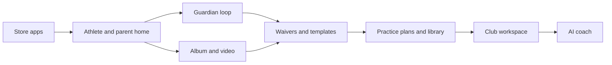

# GamePlan feature roadmap

Audience is **travel/club** (multi-team org, waivers, billing), **youth rec** (parents plus a coaching staff), and **multi-sport athletes** (one person, many teams, often different sports). The work is **sold paid features**, **club-scale org tools**, and **iOS/Android store apps**.

A team has **many coaches**. `coach` is a role many roster rows can hold; a member can also hold several roles (`rolesFromMembership` in [`lib/rules/src/index.ts`](lib/rules/src/index.ts)). Staff screens never assume a single head coach. Practice plans, events, lineups, and album uploads are team-owned and permission-gated (`manage_events`, `invite_members`, and the rest), not "the coach's."

The core loop is already in the product: accounts and minors, team roles, invite/join (including join after sign-up), schedule, RSVP, lineup, carpool, volunteer slots, fixtures, chat and polls, calendar feed, reminders, medical info, team dues, orgs with Stripe plans, and an Expo website plus native shell. Limits for album, video, practice plans, waivers, AI, and org features already live in [`lib/rules/src/index.ts`](lib/rules/src/index.ts) `PLAN_LIMITS` and are sold on [`client/expo/app/(main)/plans.tsx`](client/expo/app/(main)/plans.tsx). Those products are not built yet.

## Sequencing rules

- **Phone first.** Parents, athletes, and coaches will not run a season from the website. Store apps are a product feature, not a packaging task.
- **The person is the unit across teams.** One account, one medical record, one dues list, one calendar. A team is a membership, not a second app. Do not replace the merged schedule with a team switcher.
- **Many coaches per team.** Invites, permissions, and authored docs assume a staff, not a founder-coach. The existing per-role invite code and `assign_roles` cover adding more coaches; do not invent a head-coach role unless a club asks.
- **Sell what the copy already promises.** Do not invent a new paid SKU until album, video, waivers, practice plans, and org templates exist behind the current gates.
- **Youth rec and club share the same objects.** A waiver, album, or practice plan is a team artifact. The org layer copies or templates it. Do not build a second product for clubs.
- **Keep money on Stripe web checkout** for team and org plans. Apple/Google IAP is only for the parent add-on already described in [ARCHITECTURE.md](ARCHITECTURE.md). Team dues stay outside IAP (real-world goods).
- **Do not start AI or ads until the paid surfaces exist.** `aiMonthly` and `showsAds` are reserved; they are not the next sale.

## Now: store apps and the first-season loop

Goal: a parent or athlete who gets a text invite can install, create an account, land on a **merged** home, and use schedule, chat, RSVP, dues, and medical without a desktop — including when they (or their child) are on more than one team.

- **Ship iOS and Android.** [`client/expo/app.json`](client/expo/app.json) already has `com.gameplan.app`, an EAS `projectId`, and the `gameplan` scheme. There is no `eas.json`, store listing, privacy nutrition, review screenshots, or production signing yet. Deep links for invite, billing return, and payments return must work from a cold start.
- **Invite after sign-up stays.** The pending-invite path just added is required for store users who open `/invite/{code}` in a browser or the app. A multi-sport athlete will do this more than once; each code still joins one team.
- **Athlete and parent home is the merged schedule.** The calendar already unions every membership for the month and paints event type, not team color ([ARCHITECTURE.md](ARCHITECTURE.md)). Keep that. Add a team filter, name and logo on every row, and a mark when two teams overlap. A coach or org admin picks a team only when creating or administering, not to *see* the week. Do not add a global team switcher that hides the other sports.
- **Guardian loop that the API already allows.** Volunteer sign-up for a child, and any other "act for my kid" gaps, need screens. A parent of a multi-sport child RSVPs, pays, and later signs waivers for that child on every team from one account. Medical stays on the person, not the team.
- **Store-review blockers.** Privacy policy and account deletion, medical-info access copy, calendar-feed warning already in the app, notification permission only on tap (already true), and a clear story for web-only plan checkout (`EXPO_PUBLIC_IOS_WEB_UPGRADE` / `manageOnWeb`).
- **Reliability parents feel.** Chat history beyond one page, and a failed send that can retry. Call these polish, not a new product.

Out of this phase: MFA, PITR backups, ads, AI. Those are later unless a club deal requires MFA.

## Next: album and video (first paid surface)

Goal: the coaching staff has one place for photos and (on paid) clips. Free stays useful at 2 GB stills; Premium/Org unlock 50 GB and video (1 GB / 10 minutes per clip per `PLAN_LIMITS`). Any coach (or other role with the grant) can upload; the album is the team's.

- Team album on the team screen, using the existing media presign and download-access checks.
- Enforce `albumBytes` and `video` / `maxVideoSeconds` at upload. `UpgradeCard` already stands in when a plan lacks a feature.
- Original-quality download for paid or parent add-on (`fullQualityDownloads`). Free can keep a compressed path.
- Org later reuses the same objects; do not build an org media product first.

This is the cheapest paid feature because media upload already exists for logos, chat files, and avatars.

## Then: waivers (the club closer)

Goal: a travel club can send one packet, parents sign on the phone, and staff can see who is missing. Youth rec uses the same flow for a season medical/liability form.

- Digital waiver as a team artifact, gated by `requireEntitlement('waivers')` (already in [`functions/lib/entitlements.ts`](functions/lib/entitlements.ts)).
- Per-member (or per-child) signature, due date, and a staff missing-list. Guardians sign for minors; the same payer/guardian rules as dues.
- **Org waiver templates** — this is the "Shared … waiver templates" line already sold on the org plan. An org admin authors once; member teams attach a copy. Do not make templates a separate SKU.
- Legal review is part of the feature: what GamePlan stores, who is the contracting party (the club, not GamePlan), and what happens if a template changes after someone signed.

Without this, club sales stall even if billing and announcements work.

## Then: practice plans and the shared library

Goal: any coach on the staff writes a session, attaches it to a practice, and a club reuses a library.

- Practice plan as a **team** document with an author, not a personal notebook: title, duration, drills/notes, optional attachment. Every coach with the grant can edit. Free cap of 5; paid unlimited (`practicePlans` in `PLAN_LIMITS`).
- Pin or link a plan on an occurrence so the roster sees it next to RSVP.
- **Org shared practice library** — the other half of the sold org line. Publish a plan to the org; teams copy, they do not edit the original in place.
- Keep this behind the existing org entitlement (`orgFeatures`), not a new tier.

Youth rec gets 5 free plans so the feature is habitual before the upgrade. Clubs buy unlimited plus the library. A multi-sport athlete sees each team's plan on that team's events, not a blended "my workouts" product.

## Parallel track: club workspace

The org today is create, invite teams by directory name, accept/decline, Stripe seats (5 included, extras billed), admins, and announcements into each team's main chat. Org admins already act as `team_admin` on member teams without a roster row, and they are not in chats.

Build the workspace **after waivers and practice templates have objects to share**. Otherwise the dashboard is billing plus a chat blast.

- **Club home.** One page: plan and seats, team list with pending vs joined, missing waivers across teams, upcoming games, announcement compose. Show coaching staff per team so a director can see who is covering each roster.
- **Cross-team admin without joining every chat.** Org admins already reach team screens from the org page. Add a way to open a team's roster, medical (with `view_medical_info`), and waiver status without pretending they are members.
- **Seasons or age groups** only if a club cannot find teams by name. Do not invent a new hierarchy until two real clubs ask. Multi-sport athletes will also sit on teams in **other** orgs; the athlete home, not the club home, is how those collide.
- **Announcements stay as they are** until a club has dozens of teams. The current one-request fan-out is documented as fine for dozens, not thousands.

## Later: AI coach, parent IAP, ads

- **AI coach assistant.** 200 requests/month Premium, 1,000 Org. Ship only after practice plans exist, so the model has something to draft against (session from roster + last plan + upcoming event). Any coach on the team spends the shared monthly budget. Treat this as a thin assistant, not a new area, and gate with `requireEntitlement('ai')`.
- **Parent add-on IAP.** Removes ads and unlocks full-quality downloads for an adult on free teams. Required if ads ever ship on iOS. Build IAP when ads are real, not before.
- **Ads for free adults.** Minors never see them (`showsAds`). Do not put ads in the first store release; they complicate review and poison the parent experience.

## What this is not

- A second native app. One Expo tree stays the website and the stores.
- School SIS, referee assign, or live scoring. Fixtures and lineups are enough for v1 club games.
- Multi-region or a rewrite of DynamoDB. Measure cold start and cache headers first, as already noted in architecture.
- Changing plan prices in code. Prices stay in Stripe and in [`client/expo/src/en.json`](client/expo/src/en.json) copy.

## Assumptions (change these if wrong)

- First store submission is **iOS and Android together**, same version.
- First paid feature customers will accept is **album/video**, first club close is **waivers + templates**.
- A typical athlete or child is on **more than one team**, sometimes in different orgs and sports. The merged calendar and person-scoped medical/dues are the product; a team switcher is not.
- A typical team has **more than one coach**. No head-coach role unless a club asks.
- GamePlan is not the legal party on waivers; the club is.
- AI provider and ads network are undecided; those decisions wait until that phase.
- No hard date was given. Treat **Now** as the current quarter, **Next / Then** as the following season, **Later** as after the first club renews.
