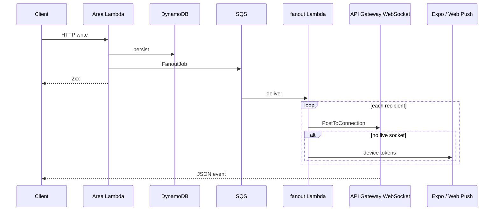

# Realtime and push

How live updates reach clients after an HTTP write. The system overview diagram is in [`ARCHITECTURE.md`](ARCHITECTURE.md#system-overview); the **Realtime and push** page in [Lucidchart](https://lucid.app/lucidchart/5dd975a6-4a54-4ddd-893c-fae6ea78e583/edit) walks through registration and delivery.

| | Choice | Main cost |
| --- | --- | --- |
| Writes | HTTP areas validate, persist, then enqueue | Others see changes slightly later than a direct broadcast |
| Delivery | SQS → fan-out Lambda | At-least-once; clients must ignore duplicates |
| Online | API Gateway WebSocket, delivery only | No replay while the socket is down |
| Offline | Expo (native) + Web Push (browser) | Token lifecycle in DynamoDB; no Amazon SNS |

## End-to-end flow

Clients change data over HTTP (`POST` messages, RSVPs, sign-ups, and so on). The area Lambda stores the row, then enqueues a **fan-out job** on SQS. The **fanout** Lambda consumes the message and, for each recipient:

1. Posts a JSON frame to every open **WebSocket** connection for that user.
2. If **no** connection accepted the post, sends **push** to registered devices (when the event type allows push).
3. For some types, sends push **even when** a socket accepted the post (see [Push rules](#push-rules)).

The write response does not wait on delivery. The queue retries; after five failed attempts the message lands on a dead-letter queue.

Areas never call each other for side effects; they share the table and use `enqueueFanout` (`functions/lib/fanout-enqueue.ts`).

## WebSocket connect

HTTP uses CloudFront → Lambda function URLs. **WebSockets still use API Gateway**, because function URLs cannot hold long-lived connections.

- **URL:** `wss://<site-host>/api/socket?ticket=…` (same host as the website and `/api`).
- **CloudFront** forwards the upgrade so connects hit the same **WAF** as HTTP (`SocketConnectIp` rate limit on `/api/socket`). WAF cannot attach to a WebSocket API directly.
- **Origin verify:** CloudFront adds `x-origin-verify` (value from Parameter Store `<prefix>/socket-origin-verify`). The `$connect` authorizer rejects connects that skip CloudFront (for example old native builds still dialing `execute-api`).
- **Ticket:** Browsers cannot set `Authorization` on a WebSocket, and putting the access token in the query string would leak into logs. The client calls `POST /identity/socket-ticket`, gets a one-time ticket (60 seconds), and passes it as `ticket`. `$connect` redeems it with a conditional delete (`functions/socket/src/authorize.ts`, `functions/lib/socket-ticket.ts`).

Open connections are stored at `USER#<userId>` / `CONN#<connectionId>`. The socket Lambda has no product logic; it only authorizes connect and handles keepalive on `$default`.

### Keepalive and reconnect

API Gateway closes idle WebSockets after **10 minutes**. The client sends a keepalive frame every **4 minutes** (`client/expo/src/live-socket.ts`), which also surfaces a socket the OS killed without a proper `close`.

**Events are not replayed** while the socket is down. Phones drop the socket when the app backgrounds, so every reconnect after the first runs `resyncAfterReconnect` (`client/expo/src/queries/live.ts`): invalidate chats, messages, schedule, sign-ups, join requests, and dues so mounted screens refetch.

On the website, reconnect also runs on `pageshow` (Safari back-forward cache) and `online`. Native uses `AppState` (foreground reconnect, background disconnect).

## Fan-out jobs

Payload shapes live in `lib/schemas/src/fanout.ts` and are shared by the queue, the socket, and push `data`.

| `type` | Typical source | Recipients | Push when no socket | Push even if socket delivered |
| --- | --- | --- | --- | --- |
| `chat_message` | `chat` | Chat members | Yes | No |
| `poll_updated` | `chat` polls | Chat members | No (socket only) | No |
| `schedule_changed` | `schedule` | Team roster (permission-filtered) | No | No |
| `signups_changed` | `schedule` sign-ups | Team roster | No | No |
| `event_moved` | `schedule` | Team roster | Yes | No |
| `event_reminder` | `schedule` reminder sweep | `userIds` on job | Yes | Yes |
| `join_requested` | `teams` | Staff who can manage invites | Yes | Yes |
| `dues_reminder` | `payments` sweep | `userIds` on job | Yes | Yes |
| `payment_received` | `payments` webhook | `userIds` on job | Yes | Yes |

Reminder and payment jobs already list **recipient user ids**, so fan-out skips a roster query.

Queue-only fields `userIds` (retry slice) and `attempt` (throttle retry count) are stripped before anything is sent to clients (`clientPayload` in `functions/fanout/src/deliver.ts`).

### Push rules

Implementation: `deliverFanoutJob` and `publishPush` in `functions/fanout/src/deliver.ts`.

- **Socket first:** If any connection for the user gets a successful `PostToConnection`, that user is considered "online" for push purposes, except for the "push anyway" types in the table above.
- **No push:** `schedule_changed`, `signups_changed`, and `poll_updated` never send push (live socket or refetch only).
- **Gone connection:** `410 Gone` from the management API deletes the `CONN#` row.
- **Throttled post:** API Gateway may throttle `PostToConnection`. Those users are requeued with `userIds` set to them only, exponential backoff (cap 60s), up to five attempts—**no push** on that attempt.

## Offline push (not SNS)

Fan-out does **not** use Amazon SNS. It reads `USER#<userId>` / `DEVICE#<deviceId>` rows and sends:

- **iOS / Android:** Expo push HTTP API (`functions/fanout/src/push-send.ts`).
- **Web:** Web Push with VAPID (`web-push`).

Devices register with `PUT /media/devices/:deviceId` (token or JSON subscription). Registration is separate from the socket.

- **Why not SNS:** SNS mobile push expects APNS/FCM platform apps and per-device platform endpoints. Web Push does not fit that model. Expo already fronts APNS/FCM for native builds.
- **Cost:** You maintain tokens in the table (refresh on register, delete on `404`/`410` or Expo `DeviceNotRegistered`).

| Config | Where |
| --- | --- |
| VAPID private key | Parameter Store `<prefix>/vapid-private-key` (fanout reads at runtime) |
| VAPID public key + subject | Lambda environment (not secret) |
| Missing VAPID | Web push skipped; Expo still works |

## Client handling

The signed-in shell wires a single `LiveSocket` (`client/expo/src/live-socket.ts`) and applies events in `applyLiveEvent` (`client/expo/src/queries/live.ts`):

- **`chat_message`:** Prepend into the open thread cache if loaded; invalidate chat list. Duplicates are skipped upstream in the shell.
- **`poll_updated`:** Patch poll tallies in cache (no push).
- **`schedule_changed` / `event_moved` / `event_reminder`:** Invalidate that team's schedule and fixtures queries.
- **`signups_changed`:** Invalidate sign-ups for that occurrence.
- **`join_requested`:** Invalidate join requests for the team.
- **`dues_reminder` / `payment_received`:** Invalidate my dues and team charges.

See [Client cache](client.md#client-cache) for TanStack Query defaults and persistence (live events do not persist message history).

## Asking for notifications

Permission is requested only from a tap on the notification banner or the profile button (`client/expo/src/notification-prompt.tsx`). "Not now" hides the banner for seven days. Each launch re-saves an already-allowed subscription without prompting.

iPhone Safari only allows web notifications from the Home Screen app, so the site ships a web app manifest and the banner explains Add to Home Screen in a normal tab. A notification tap opens the relevant screen (`public/sw.js`).

- **Why:** Safari ignores prompts not triggered by a gesture; iOS allows one system dialog, so context first protects that chance.
- **Cost:** Users who dismiss the banner stay unsubscribed until they opt in from profile or the banner returns.

## Local development

With `npm run up`, areas do not talk to real SQS unless configured. Chat and schedule tests often **POST** the job body to **`POST /fanout/deliver`** on the fanout process so delivery runs inline. The local stack may use a lightweight WebSocket server instead of API Gateway; set `WEBSOCKET_CALLBACK_URL` accordingly.

## Key files

| Path | Role |
| --- | --- |
| `lib/schemas/src/fanout.ts` | Job schema and event types |
| `functions/lib/fanout-enqueue.ts` | SQS enqueue (or local deliver URL) |
| `functions/fanout/src/deliver.ts` | Socket post, push, throttle retry |
| `functions/fanout/src/push-send.ts` | Expo + Web Push |
| `functions/fanout/src/routes/sqs.ts` | Queue consumer |
| `functions/socket/src/authorize.ts` | `$connect` ticket + origin verify |
| `client/expo/src/live-socket.ts` | Connect, keepalive, reconnect |
| `client/expo/src/queries/live.ts` | Cache updates and resync |
| `infrastructure/lib/site-api.ts` | CloudFront `/api/socket` behavior |

## Operations notes

- **First deploy gap:** API may require `x-origin-verify` before the site stack attaches the header to CloudFront; connects can fail for a few minutes (`ARCHITECTURE.md` gaps).
- **Old native builds:** Still using `execute-api` miss live socket delivery until rebuilt against `wss://<site>/api/socket`; HTTP writes and push still work.
- **IAM:** `fanout` may delete `USER#` items when cleaning gone connections or devices; it only deletes the known connection or device sort key.
