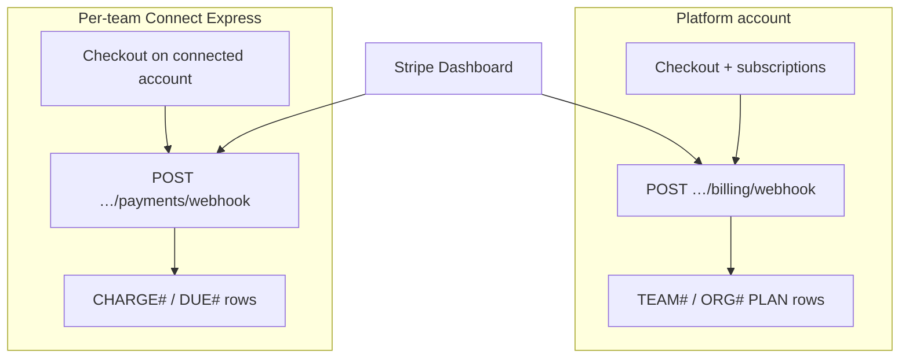

# Stripe

GamePlan uses Stripe in three separate ways: **Connect** for team dues on each team's Express account, **Billing** on the **platform** account for premium and organization subscriptions, and **app stores** for the parent add-on (not Stripe). Product rules for plans, organizations, and dues sit in [`ARCHITECTURE.md`](ARCHITECTURE.md#stack); this doc is wiring, keys, webhooks, and Terraform.

| Flow | Stripe account | GamePlan area | Checkout / portal |
| --- | --- | --- | --- |
| Team dues | Team **Connect** Express | `payments` | Hosted Checkout on connected account |
| Premium / org plans | **Platform** | `billing`, `orgs` | Billing Checkout + customer portal |
| Parent add-on | Apple / Google IAP | (not Stripe) | See [store-release.md](store-release.md) |

Staging uses Stripe **test mode**; production uses **live mode**. The Terraform apply checks that `<prefix>/stripe-api-key` matches the environment.

## Architecture sketch

- **Dues:** Direct charge on the connected account with `application_fee_amount` (`PLATFORM_FEE_BPS`, default 2%). Processing fees come out of the team's share so the platform fee stays whole.
- **Subscriptions:** Prices are resolved by **lookup key** (`premium_monthly`, `org_yearly`, …) in `functions/billing/src/gateway.ts`, matching products and prices in `infrastructure/terraform/stripe.tf`.
- **Organization billing:** One subscription with base price (five teams included) plus `org_extra_team_*` quantity for teams past five; `syncOrgSeats` updates quantity on join/leave.

## Webhook endpoints

There are **two** endpoints. Both target **public Lambda function URLs** (auth `NONE`), not CloudFront `/api/*`.

| Endpoint | URL path | Stripe type | Lambda | Signing secret (SSM) |
| --- | --- | --- | --- | --- |
| Payments | `POST …/payments/webhook` | **Connect** (`connect = true`) | `payments-webhook` | `<prefix>/stripe-webhook-secret` |
| Billing | `POST …/billing/webhook` | **Platform** | `billing-webhook` | `<prefix>/stripe-billing-webhook-secret` |

**Why not CloudFront:** Browser API traffic uses CloudFront origin access control (SigV4). Stripe sends only `Stripe-Signature`; it cannot sign for OAC. Dedicated webhook Lambdas expose a public function URL and verify the Stripe signature on the raw body. See `infrastructure/lib/api.ts` (stack outputs `PaymentsWebhookUrl`, `BillingWebhookUrl`).

**Security note:** Those URLs skip CloudFront WAF. Each function URL's resource policy also allows invokes only from Stripe's published webhook IPs (`infrastructure/data/stripe-webhook-ips.json`, refreshed by a weekly GitHub workflow). The **signing secret** remains the primary gate. See [`security.md`](security.md#exceptions-public-urls).

### Registered events

Lists in `infrastructure/terraform/stripe.tf` must match the switches in each area's webhook handler.

| Payments (Connect) | Billing (platform) |
| --- | --- |
| `checkout.session.completed` | `checkout.session.completed` |
| `checkout.session.async_payment_succeeded` | `customer.subscription.created` |
| `checkout.session.expired` | `customer.subscription.updated` |
| `checkout.session.async_payment_failed` | `customer.subscription.deleted` |
| `charge.refunded` | |
| `account.updated` | |

Handlers: `functions/payments/src/webhook.ts`, `functions/billing/src/webhook.ts`. Entry Lambdas: `webhook-handler.ts` in each area (only webhook + health).

### Where to see them

1. **Stripe Dashboard** → [Developers → Webhooks](https://dashboard.stripe.com/webhooks). Toggle **Test mode** vs **Live** to match staging or production. Each endpoint shows URL, enabled events, and **recent delivery attempts**.
2. **Connect vs platform:** The dues endpoint is a Connect webhook (events on connected accounts). Billing is on the platform account. Both appear in the webhooks list after Terraform creates them.
3. **AWS URLs:** CloudFormation stack **GamePlanApi** → outputs `PaymentsWebhookUrl` and `BillingWebhookUrl` (function URL + path).
4. **Terraform outputs:** `stripe_payments_webhook_id`, `stripe_billing_webhook_id` (`infrastructure/terraform/outputs.tf`).

Terraform creates the endpoints and writes signing secrets to Parameter Store on apply. Functions read secrets at runtime (five-minute cache); no redeploy needed when Terraform rotates a secret.

### Idempotency and ordering

- **Dues:** Due writes use conditional `version`. Events apply only to the team whose connected account sent them. Checkout sessions are reused when still open.
- **Billing:** Subscription events are the source of truth for `PLAN` rows. Checkout completion mainly records `BILLING` / `STRIPE_CUSTOMER#`. Writes skip when `stripeEventCreated` on the stored row is newer; `incomplete` subscriptions write nothing. Org-copied plans block a team's own subscription from overwriting.

## Keys and Parameter Store

| Parameter | Who uses it | Set by |
| --- | --- | --- |
| `<prefix>/stripe-api-key` | Terraform Stripe provider only | Hand (test key staging, live key production) |
| `<prefix>/stripe-secret-key` | `payments`, `payments-webhook`, `billing`, `billing-webhook`, `orgs` | Hand (dashboard; same mode as environment) |
| `<prefix>/stripe-webhook-secret` | Connect webhook verification | **Terraform** (`stripe_webhook_endpoint.payments`) |
| `<prefix>/stripe-billing-webhook-secret` | Billing webhook verification | **Terraform** (`stripe_webhook_endpoint.billing`) |

Terraform and the Lambdas use **different parameter names** on purpose: apply never needs the secret key in CI job env vars beyond what Terraform reads from SSM.

Deploy workflow: `cdk deploy` then `terraform apply` from `infrastructure/terraform`, because webhook URLs come from the **GamePlanApi** stack. Details: [infrastructure/terraform/README.md](../infrastructure/terraform/README.md).

## Products and prices (Terraform)

`stripe.tf` defines products and recurring prices with **lookup keys** (amounts in cents; must match plan copy in `client/expo/src/en.json` and `es.json`):

| Lookup key | Product | Interval | Amount (cents) |
| --- | --- | --- | --- |
| `premium_monthly` | Premium | month | 900 |
| `premium_yearly` | Premium | year | 9000 |
| `org_monthly` | Organization | month | 3500 |
| `org_yearly` | Organization | year | 35000 |
| `org_extra_team_monthly` | Extra team | month | 500 |
| `org_extra_team_yearly` | Extra team | year | 5000 |

Stripe API version pinned in Terraform: `2026-08-26.dahlia` (must stay aligned with the Stripe SDK in functions).

**Changing a price:** Edit `unit_amount` in `stripe.tf` and translation strings. Stripe cannot change an existing price amount; Terraform creates a new price with `transfer_lookup_key = true`. New checkouts use the new price; existing subscribers stay on the old price until moved—the billing webhook ignores unknown lookup keys (`unknown_plan_or_pending`) for those subscriptions.

**Changing webhook events:** Add to `stripe.tf` and to the handler `switch`.

**Not managed in Terraform:** Secret API key for Lambdas, default billing portal configuration (code uses account default).

## Subscriptions (product behavior)

Premium and organization plans are **Stripe Billing** subscriptions on the **platform** account, sold on the **website**; the parent add-on goes through Apple and Google in-app purchase ([store-release.md](store-release.md)).

The **`billing`** area opens Checkout (`POST /billing/teams/:teamId/checkout`, `manage_billing`) and the customer portal for plan changes, cards, cancellation, and invoices. Prices are found by **lookup key** (`premium_monthly`, `premium_yearly`, …), so test and live mode run the same code and a price change needs no deploy. Stripe returns to a fixed `GET /billing/return` with a target from a closed list (`app` or `web`), like dues.

**Source of truth:** subscription webhook events update `PLAN` rows. Checkout completion only records the customer (`TEAM#id` / `BILLING`, plus `STRIPE_CUSTOMER#<id>` when metadata is missing). Plan writes skip when the stored row came from a newer Stripe event (`stripeEventCreated`); every write is conditional on `version`. **`incomplete`** subscriptions write nothing. A team whose plan comes from an organization cannot start its own subscription, and its own subscription events do not overwrite the organization's plan.

- **Why:** Web checkout avoids store fees on team and org plans; Stripe hosts cards, invoices, tax, and dunning. Event-time ordering makes retries and out-of-order delivery safe.
- **Cost:** iOS may only link to web checkout where Apple allows (`EXPO_PUBLIC_IOS_WEB_UPGRADE` from `<prefix>/ios-web-upgrade`). Two webhook endpoints and secrets. Prices on the plans screen are **translation copy**—change Stripe and `en.json` / `es.json` together.

**App:** `teamEntitlements` (`client/expo/src/plan.ts`) uses the team summary and `entitlementsFor`. `UpgradeCard` prompts upgrades. Checkout/portal via `openStripePage` → `gameplan://billing`; `app/(main)/billing.tsx` handles cold start. Plan status is not persisted on device (same as dues).

Plan **tiers** and entitlements (`PLAN_LIMITS`, `requireEntitlement`) are product rules in [`ARCHITECTURE.md` — Plans and entitlements](ARCHITECTURE.md#plans-and-entitlements).

## Return URLs and deep links

Stripe redirects are fixed server routes with a **closed** `target` list (`app` or `web`), never a client-supplied URL:

- Dues: `GET /payments/return` → `gameplan://payments` when returning to the app.
- Subscriptions: `GET /billing/return` → `gameplan://billing` (`app/(main)/billing.tsx`).

Native opens Checkout/portal via `openStripePage` and waits for the billing or payments deep link. See [store-release.md](store-release.md) for `EXPO_PUBLIC_IOS_WEB_UPGRADE` and when iOS may link to web checkout.

## DynamoDB touchpoints (Stripe-related)

| Prefix / sort | Written by |
| --- | --- |
| `TEAM#` / `CHARGE#`, `DUE#`, Connect `STRIPE_ACCOUNT#` | `payments`, payments webhook |
| `TEAM#` / `PLAN`, `BILLING`; `STRIPE_CUSTOMER#` | `billing`, billing webhook, org flows |
| `ORG#` / `PLAN`, `BILLING` | `billing`, `orgs`, billing webhook |

IAM: payments webhook writes only `TEAM#` and `STRIPE_ACCOUNT#`; billing webhook writes `TEAM#`, `ORG#`, and `STRIPE_CUSTOMER#` (see ARCHITECTURE least-privilege table).

## One-time migration notes

If Stripe already has manual products or webhooks:

- **Prices:** No import needed; new Terraform prices take lookup keys; archive old prices when unused.
- **Webhooks:** Endpoints cannot be imported with their signing secret. Let Terraform create new endpoints, delete old ones in the dashboard, then apply so SSM secrets update.

If webhook endpoints were created before CDK outputs existed, register URLs from **GamePlanApi** outputs on the next deploy + apply.

## Key files

| Path | Role |
| --- | --- |
| `infrastructure/terraform/stripe.tf` | Products, prices, webhooks, SSM secrets |
| `infrastructure/lib/api.ts` | Webhook Lambdas and public function URLs |
| `functions/billing/src/gateway.ts` | Lookup keys, Checkout, portal, verify |
| `functions/billing/src/webhook.ts` | Subscription and checkout events |
| `functions/payments/src/stripe.ts` | Connect client and webhook verify |
| `functions/payments/src/webhook.ts` | Dues and account events |
| `functions/lib/stripe-client.ts` | Shared Stripe client helper |
| `client/expo/app/(main)/billing.tsx` | Billing return deep link |
| `client/expo/app/(main)/teams/[teamId]/payments.tsx` | Dues UX |

## Local development

Local stack uses test keys from env or Parameter Store overrides. Webhooks do not reach localhost unless you use [Stripe CLI](https://stripe.com/docs/stripe-cli) `listen --forward-to` or point a test endpoint at a tunnel. Dues and billing flows can be exercised in staging with test cards.
